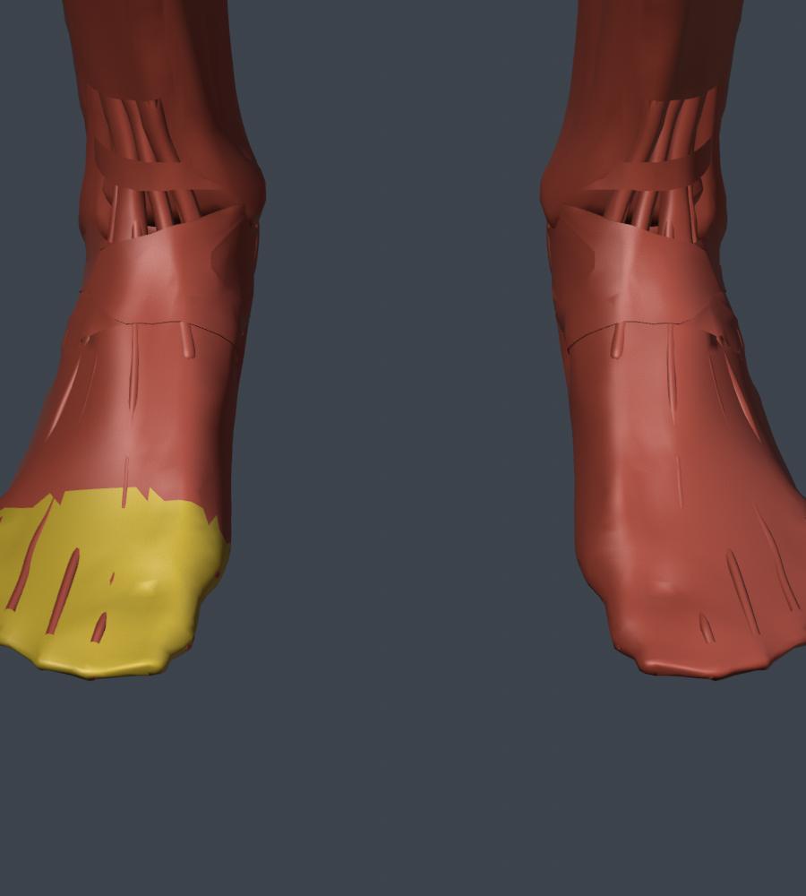
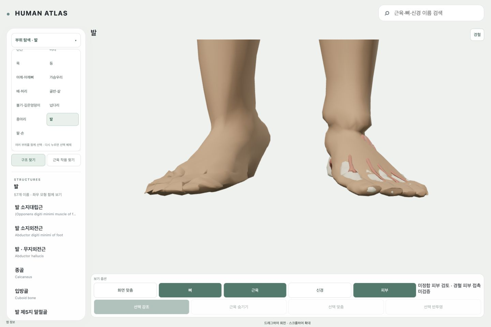
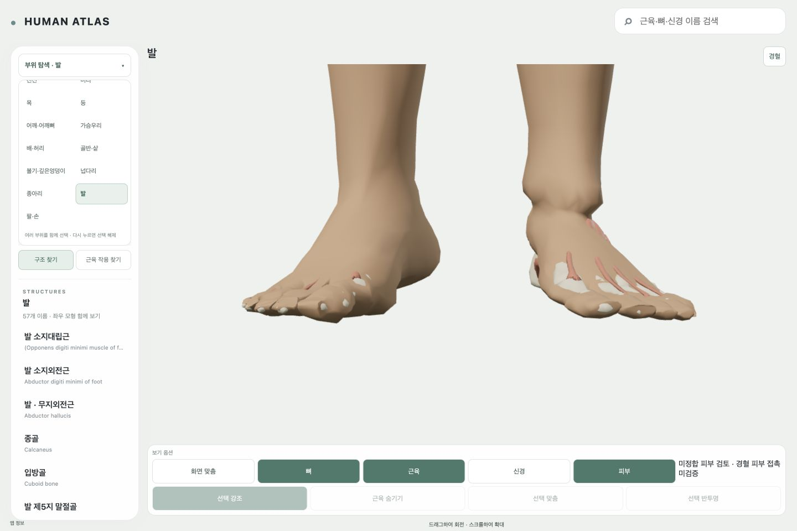
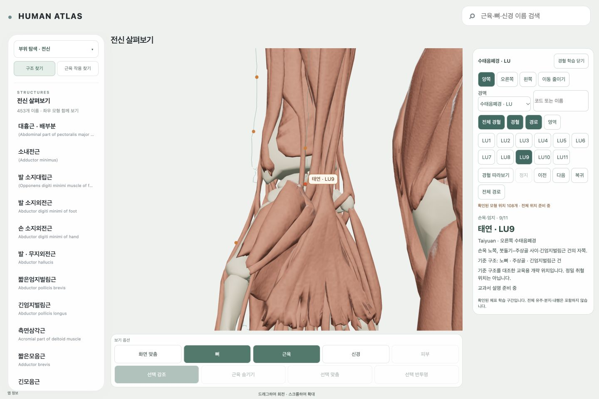

# AT10 완료 요청의 실제 결과 — 2026-10-14 r1

**AT10은 미완이다. acceptancePassed=false, 통과 전신 피부0, 신규 피부 anchor0이다.** 이번 실행은 기존 완료 계획에 따라 F1 오른발의 대응/변형을 실제 수정하고, 별도로 확인된 전체108개 전달 오류와 피부 loader의 pose ID 오류를 해결했다. F1의 형태·관통 기준을 함께 충족하지 못해 제품 피부로 등록하지 않았다. 시간 경과, 과거 deferred, 교수 승인 또는 전신 source 부재 때문에 멈춘 것이 아니다. 담당 정합 구현이 실제 필수 기준을 해결하지 못한 결과다.

시작 HEAD는 `bf2f970dc7fb71eaf323b88352314cd856786732`다. [시작 상태](../evidence/AT10/2026-10-14-completion-r1/start.json), [입력·WIP 보존 검사](../evidence/AT10/2026-10-14-completion-r1/preservation-checks.json)에 45개 기존 tracked WIP와 실제 입력 hash가 있다. 최신 입력은 그대로이며 source 확보/Luna portfolio/완료한 전수 검사를 반복하지 않았다. 원본 Startup.blend SHA `9f08a17ea0115fed80b2a73ecdf0a1bc2ab2f6956f37c593ce23d513ea35afcd`도 최종 대조했다.

## 승인된 참조 분리와 적용 범위

사용자가 **“주소별 근거를 남겨 단순화된 fascia 구역을 정합 기준에서 분리”**를 명시 승인했다. [승인 기록](../evidence/AT10/2026-10-14-completion-r1/authorization-r1.json)과 [정확한 면 정책](../evidence/AT10/2026-10-14-completion-r1/reference-exceptions-right-r1.json)을 새로 저장했다.

대상은 오른쪽 Crural fascia `ZA-c7010a9-97a5556947c926b0b5483338`의 **991 triangle**이다. 원본 총10,875면 중 **9,884면은 계속 정합 참조**다. 실제 native-only 화면에서 발가락 사이까지 이어진 연속 sleeve를 확인했고, 실제 다섯 MTP-cap 축 평면보다 먼 쪽의 연결 구역을 cross-digit seeds230개에서 추적했다. source key/geometry SHA/side/triangle 목록·선정 경계·근거를 저장했다. 나머지 fascia·뼈·힘줄·주변 구조를 제거하거나 기본 OFF라는 이유로 제외하지 않았다.

이 분리는 정합용 참조 분류다. native 원본은 그대로이고 **834 objects / 2,729,450 native triangles 전체 raw 검사**도 유지한다. 왼쪽을 mirror로 분리하지 않았고, 피부·지표·혈위의 합격으로 확장하지 않았다. raw와 분리 후 유효 참조 수를 섞지 않는다. assessment도 실제 원본 geometry SHA를 검사하며 candidate를 수정하지 않는다.

## 실제 정합 시도와 실패

| 후보 | 전체 raw 교차 피부 면 / self pair | 오른발 raw / 분리 후 유효 교차 면 | 결과 |
|---|---:|---:|---|
| r55 | 2,878 / 1,334 | 907 / 605 | 실제19 toe chain+source harmonic weight로 단면을 보존했으나 바닥 -7.158mm와 관통 실패 |
| r56 | 2,391 / 1,334 | 513 / **21** | 국소 self0, sampled J 양수. **각지고 접힌 발끝 형태와 잔여 관통으로 미채택** |
| r58 | 2,624 / 1,334 | 730 / **228** | 원형/접촉을 같은 목적함수로 처리했으나 관통 증가. 실제 앱에서도 미달 |

r56의 [남은21면·208 native pair](../evidence/AT10/2026-10-14-completion-r1/right-foot-remaining-r56.json)는 source face/original vertex와 native source/triangle/world 좌표로 기록했다. 제1·5중족골/제1·5발가락 기절골/발가락 폄힘줄과 남겨 둔 fascia가 포함된다. nearest/ray는 포함/정합 계산에만 사용했고 혈위 의미의 근거로 쓰지 않았다.

solver에 실제 native/self 교차와 양의 변형 조건을 함께 넣고 첫차 Jacobian 부등식, hard contact 대안, 형태 prior를 시험했다. line search가 contact 에너지만 보고 형태 목적함수를 무시하던 문제를 고쳤으며 non-finite trial을 명시 거부한다. hard QP r57은 잔여 위반과 경고를 남긴 채 r56 좌표와 정확히 같아 실패로 기록했다. 통과했다고 바꾸지 않았다.

r56은 vertex1,249 + face centroid2,474 + source 체적497 표본에서 최소 sampled J 약0.006785, 체적 최소0.591915, replay 오차6.61e-11m를 보였다. r58은 최소 sampled J0.014197/체적0.216203이다. 이는 **유한 표본 검사**이며 전역 injectivity·상동 지표·외관의 증명이 아니다. 독립 emitted 검사와 실제 화면의 실패가 우선한다.

거친 삼각형의 chord 문제인지 구분한 r59 국소 세분화는 유효 교차21→119→337, self0→13→47로 악화했다. 단순 해상도 부족으로 설명할 수 없어 GLB로 채택하지 않았다. source shape 기반의 dense 초기장 r60/r61도 제5발가락 source query `[-0.21347,-0.80155,0.1554]`와 인접3 centroid에서 비양의 Jacobian이 나와 **초기 단계에서 거부했으며 GLB를 만들지 않았다.** r61의 최소 J는 약-0.394다. 이 구역의 연속 단면/경계 대응과 실제 양의3D 변형을 해결해야 한다.

원본 UV/helper/ID와 source unit 밖 위치는 그대로다. 성공한 r41 양손의 local contact native0/self0는 독립적으로 보존한다. r22 primary checkpoint의 geometry=false/native3,874/self1,604(옛648 reference)도 덮지 않는다. [attempt ledger](../evidence/AT10/2026-10-14-completion-r1/attempt-ledger.json)에 모든 채택/미채택·reference 범위·실제 비용을 분리했다.

## 실제 loader 오류 해결과 화면

실제 앱은 기존 정합 파일의 pose 별칭 `za-c7010a9-9f08a17ea011-frame0-static`을 current dataset의 `ZA-9f08a17ea0115fed-frame0-autoexec-off`와 다르게 판단해 읽기를 거부했다. 발 fascia/Radius/Mandible의 실제 현재 detail GLB/world 좌표와 기존 native 표본이 **정확히 같은지** 대조하고 source SHA/frame0에 binding했다.

`r41p1/r56p1/r58p1`은 새 versioned **메타데이터 수정본**이다. 원본 GLB를 덮지 않았고 binary position/normal/UV/index는 수정 전과 byte-exact다. geometry acceptance/learnerEligible는 false다. exporter의 기존 revision 기본 동작도 유지한다. pose 이름만 바꿔 피부 합격으로 세지 않는다.

DEV `skinReview=1`의 같은 공통 SkinLayer/AnatomySceneRoot/renderer/camera에서 실제 emitted r56p1/r58p1을 읽었다. 각 파일은 **626,576bytes / 26,756 triangles / decoded geometry625,080bytes**, texture0/material1이다. r58p1 SHA는 `06f6a9216165fc7f5e701a426acbe24778ee116d81c3afcf5804ae3b80695efe`, r56p1 SHA는 `66be5e641fdf318ae9d47a1890556005da2aa0d90e418f32dcb9683fdc822665`다. 원본 r56/r58 GLB와 모든 raw QA는 그대로다.

실제 전신/발 양측/머리·귀·목과 1440·1024·390 표시를 확인했다. region 전환 동안 같은 root를 유지했고 OFF에서 cost0/추가 frame callback0으로 돌아왔다. r58의 얼굴/eyelid/oral/ear/neck도 미달이다. 이 화면은 **미합격 개발 검토**이며 product learner import나 G1–G8 피부 합격으로 세지 않는다. resize 직후의 미정착 screenshot도 남기고 정착 후 화면을 따로 기록했다. offline Blender 화면으로 learner 검증을 대신하지 않았다.

## 기존108개 전체 표시 회귀 해결

기존 common gzip observation decoder를 재사용해 LU observation JSON139,176bytes를 gzip30,822bytes로 전달했다. 원문 JSON과 decoded SHA/좌표·경로를 그대로 보존하는 `--preserve-source`를 넣었고 registry는 delivery 경로/hash/encoding만 바꿨다. 새 loader나 전역 제한 완화는 없다.

실제 앱 ‘전체 경혈’은 양측 **108개**, encoded overlay **823,127bytes**, base 포함 **20,865,643bytes**로 기존20MiB에서 **105,877bytes 여유**를 확인했다. LU9/왼 LU11/오른 LU5, 양측→왼쪽→오른쪽, 1440/1024/390, 패널 닫기/기존 장면 복귀를 확인했다. source ID로 경혈 선택을 위장하지 않았다. legacy 교육용 개략108개이며 정밀 피부 접촉108개가 아니다.

피부까지 단순 추가하면 **21,492,219bytes**로 여전히20MiB보다 **520,699bytes 초과**한다. shared canonical carrier/delivery 비용 해결은 R1/R2의 미완이다. 기존 근육/뼈를 삭제하지 않았고 예산을 올리지 않았다. 실제 driver VRAM/FPS 합격은 주장하지 않는다. 제품 registry는 null, 피부 버튼은 비활성이고 새 피부 point/영역 공유/361혈/취혈자세는 추가하지 않았다.

## 검사·미완·커밋 경계

관련 자동 검사25개와 overlay/mask/lifecycle 회귀, typecheck 포함 전체 build가 통과했다. actual current pose metadata 수용/옛 별칭 거부, 모든 binary buffer 불변, learner gate 유지, 바이트/hash 변조 거부, 취소/dispose/motion guard, packed observation 원문 동일성을 검사한다. production dist에는 skin review 모듈/후보 GLB/증거가 없다. source/공개 권리·AI 작성·교수 검토·기술/위치 등급은 분리하며 public held를 바꾸지 않았다.

정확한 [remaining units](../evidence/AT10/2026-10-14-completion-r1/remaining-units.json)는 F1의 연속 발 대응/양의 변형, F2 실제 왼발, F3 머리/귀/목/return, F4 겨드랑/샅/seam, F5/F6 전신·지표·재현/최종 화면, R1/R2 통과 피부/108접촉·영역 공유·동시 예산, C1 미표시124개 reconciliation이다. 외부 source 전체를 새로 요구하거나 사람 승인 대기로 바꾸지 않는다. [재개 프롬프트](../evidence/AT10/2026-10-14-completion-r1/next-skin-fit-prompt.txt)는 같은 AT10/F1이며 **후속을 자동 실행하지 않는다.** 전신 합격 후 예정만 skin-runtime이다.

소유 코드·도구·선택 자산·versioned 증거·보고서·AT10 담당 record만 로컬 commit한다. 기존45 WIP/원본/OpenSim_Models/T13/다른 AT·MV/Luna 산출물과 역사 증거는 제외·보존한다. 실패 중간 원문은 삭제하지 않고 선택 recipe archive와 hash index로 남긴다. sync_execution.py와 --check 결과 및 실제 commit hash/정확한 파일 경계는 이 evidence의 scoped-checks/commit-scope/commit-receipt에 남긴다. push/배포/위임/다음 AT는 실행하지 않았다.
