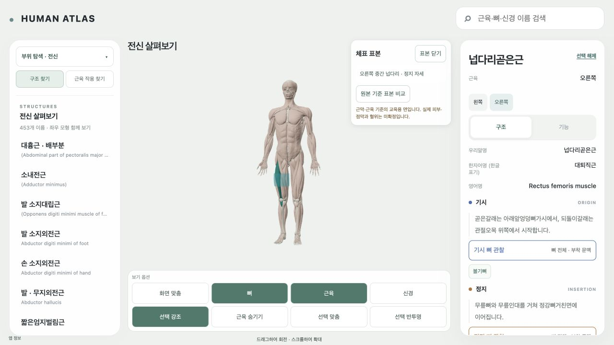

# AT2 — source-bound 교육용 체표 경로와 실행 표본

AT2의 **한 경로 결정 + 실행 가능한 실제 표면 표본** 기준을 완료했다. 기존 Z-Anatomy의 native 근막·근육 외곽에서 부위별 교육용 체표를 작성하는 경로를 채택했다. 같은 AnatomySceneRoot에 오른쪽 중간 넙다리 둘레 표본 1개를 표시하고 앞·옆·뒤에서 원본 기준 면과 비교했다. 전신 피부/점막 완성, 실제 피부 정확성, 혈위 승인으로 해석하지 않는다. 생성/승인한 경혈 instance는 0개이며 AC1/AC2의 22개 proposal은 unresolved 그대로다.

읽고 재사용한 기준은 AGENTS.md, 최신 EXECUTION/NEXT, AT2 명세, 30/31 설계, AT1 catalog 실제 검증, AC1 source-probe/decision/runtime/carrier 검증, AC2 report와 기존 schema/anchor adapter/entry였다. 새 다운로드와 Blender 원본 재추출 없이 AC1의 read-only `world()` reader와 현재 ZA cache를 재사용했다. builder는 AST로 이 함수만 읽으므로 AC1의 과거 writer를 실행하지 않는다. 기존 CameraSessions/tour/point schema를 새로 만들지 않았다. 이 표본은 카메라 명령이나 관찰 session을 요청하지 않는다.

`source-sample.json`에는 입력 GLB 9개와 unit metadata 9개의 실제 hash, 객체별 world bounds/side/triangle 수, 적용한 변환과 source 권리를 기록했다. `native-ray-hits.json`에는 각 표본의 실제 sourceKey, triangle, barycentric, ray 교차 수를 남겼다. 원본 기준 표본과 제안 면 모두 topology hash 검증을 거친다.

| 항목 | 결정/검증 결과 |
|---|---|
| Source | Z-Anatomy revision `c7010a903b75a2fd24a13b1c2c4c3546a9223780` |
| 원본 Blender SHA-256 | `9f08a17ea0115fed80b2a73ecdf0a1bc2ab2f6956f37c593ce23d513ea35afcd` |
| Package 권리 | pinned CC BY-SA 4.0, BodyParts3D CC BY-SA 2.1 Japan attribution 유지 |
| 권리 범위 | 로컬 기술 관찰 supported; public redistribution held; 교수 검토 not_performed. 개별 객체의 불명확한 upstream ancestry를 창작하지 않음 |
| 권리 선행 | `work/evidence/T98/astra-resolution-2026-09-29/rights-scope.json`, `source-readme.md` |
| Frame/unit | `HUMAN_ATLAS_RH_M_XLEFT_YHEAD_ZANTERIOR`, metre |
| Pose | `za-c7010a9-9f08a17ea011-frame0-static` 정지 기준 자세만 |
| Side | 실제 오른쪽 source 객체별 확인; 모든 제안 vertex x<0; 왼쪽 mirror 미사용 |
| 표본 | 오른쪽 중간 넙다리, world y=0.588920–0.725252 m, 약 13.6 cm의 360° 띠 |
| 위상 | 1,024 vertices / 1,920 triangles / 1 connected component / 열린 양끝 128 boundary edges; 둘레 seam은 wrap index로 닫힘, caps 없음 |
| Carrier hash | `4af270eeb09114a8c0a5d4668636f8777d105b5a326294ddff1ef5f14dbb83c6` |

현재 cache에 전체 피부·점막 carrier가 없다는 AC1의 precise failure를 재사용했다. 이는 모든 upstream asset에 피부가 없다는 주장이 아니다. ZA empty skin collections와 BP3D의 metadata/cache geometry 부재를 다시 이름 검색하거나 다운로드하지 않았다. 선택한 대안은 **현재 native 표면에 정합한 분할 교육용 envelope** 하나다. 전체 피부 입력을 기다리며 이 독립 기술 검증을 막지 않았다.

대퇴골의 실제 mid-shaft 단면 bounds 중심을 ray 원점으로 사용하고, 16개 높이 × 64개 둘레 방향에서 20 cm 이내의 가장 바깥 실제 삼각형 교차점을 읽었다. 이는 표본 영역을 고르는 기술적 기준이며 cun이나 혈위 landmark가 아니다. 넙다리근막(Fascia lata) 806개, 가쪽넓은근(Vastus lateralis) 218개의 교차점이 최종 면에 기여했다. 나머지 6개 근육도 교차 후보로 실제 읽었지만 이 영역에서 바깥 hit 기여는 0개다. 대퇴골은 표본 축 입력이다. missing ray/nearest-vertex fallback은 모두 0개다. source-local GLB에 unit matrix를 한 번만 적용했고 AC1 runtime bounds와 0.1 mm 미만 차이로 일치했다.

원본 기준 vertex는 native triangle 위에 있다. 제안 면은 원본 표본에서 radial 6 mm의 **시각적 여유**를 둔다. 이것은 피부·피하조직 두께가 아니다. 초기 4 mm 후보는 triangle centroid에서 약 0.594 mm 관통하여 기각했고 `failure-history.json`에 남겼다. 최종 6 mm 후보의 1,920 triangle centroid를 다시 native envelope와 대조한 clearance는 1.428–14.035 mm이며 outward winding, 최대 edge 18.605 mm를 확인했다. 이 수치는 centroid 표본 검사다. 모든 triangle 내부의 무관통이나 실제 피부 정확성을 증명하지 않으며, 최대 간격도 교육용 coarse 면의 한계로 남긴다.

실제 표시 검증과 비용은 다음과 같다.

| 검증 | 실제 결과 / evidence |
|---|---|
| 표면 표본 재현 | 1,024 barycentric/native triangle replay, 최대 오차 2.4923e-8 m; `validate_sample.py`, `validation.json` |
| 실제 화면 | 1280×720 기본 viewport에서 front oblique/right lateral/back oblique 3시점. 같은 root의 표본 1개; `surface-views.json`, 각 proposal/native PNG |
| 비교 | 같은 geometry/material의 position buffer를 교체하여 native 기준/제안 면 비교; 추가 geometry 증가 없음 |
| 카메라/선택 | OFF/ON/reference/OFF의 camera/target/selection/region/pose가 동일; 실제 확인을 위한 확대·회전은 기존 선택 맞춤/수동 orbit만 사용 |
| Layer-off | 뼈/근육을 꺼 둔 상태가 ON/OFF 후에도 보존됨; `layer-off-preservation.json`, `layer-off.png` |
| 기존 클릭 | 표본 위 실제 클릭으로 native 오른쪽 대퇴이두근 긴갈래 선택·일반 해부 카드 열림, 표본 종료; `anatomy-click.json/png` |
| 해제 | 닫기/재진입 5회마다 geometry 399→398, update 1→0, shader program 3→2; `toggle-cycles.json` |
| 지연 로딩 | 새 페이지의 검토 OFF일 때 sample module/data request 0; 켠 뒤 읽음. `final-before-display.json`, `final-runtime.json` |
| 관련 자동 검사 | anchor/sample 총 9 tests, typecheck, 직접 Vite production build, 기존 lazy build check 통과 |
| 최종 console | 새 최종 검토 탭의 warning/error 0; `console.json` |
| Learner bundle | production manifest/JS에 sample inspector·carrier·evidence marker 없음. 개발 opt-in 표본만 제공 |

추가한 개발 검토기는 기존 작은 AC entry에서 `carrierSample=1`일 때만 열린다. module/data를 지연 읽고, fetch AbortController와 기존 entry generation 취소를 사용한다. hash 검증 뒤 late cancellation과 active motion/acupoint camera owner를 재확인하여 정지 면을 할당하지 않는다. source motion/선택·자세 변경, 화면 비활성화, WebGL context loss와 unmount에서는 자기 resource를 해제한다. 수동 orbit은 그대로 허용한다. 이번 AT2에서 motion 재생 화면을 새로 검증한 것은 아니며, active-motion/late cancellation 차단은 자동 검사이고 motion 소유권 선행은 AC2 evidence와 구분한다.

소유 GPU buffer는 Float32 position+normal 24,576 bytes와 Uint16 index 11,520 bytes, 합계 **36,096 bytes**다. 같은 카메라에서 renderer가 센 실제 차이도 36,096 bytes / geometry 1 / draw call 1 / triangles 1,920으로 일치했다. texture는 0개다. JSON 전체(원본 비교 좌표 포함)는 **148,379 bytes**다. driver heap과 GPU 실행 시간은 측정하지 않았으므로 해당 비용/FPS를 확정하지 않는다.

| 기존 예산 유지 | 표본 포함 값 | 기존 상한 |
|---|---:|---:|
| 보수적 overview bytes | 20,190,895 | 20,971,520 |
| overview triangles | 899,132 | 1,000,000 |
| 현 검토 runtime geometry queue + 표본 | 17,473,644 | 100,663,296 |

기존 budget 상한을 올리지 않았다. 실제 화면에 그려진 triangles는 고정 카메라 기준 169,521→171,441이었다. overview 전체 수, 화면 렌더 수, GPU buffer 수를 구분한다. 추가 전신 chunk를 이 여유 안에 넣을 수 있는지는 후속 범위별로 다시 판단해야 한다.

검증된 적용 부위는 오른쪽 중간 넙다리 띠 하나다. 몸통·위팔·나머지 다리는 방법 후보이며 아직 적용 완료가 아니다. 머리, 손, 발, 발바닥, 회음부, 구강점막, 왼쪽, 변형 자세는 이 표본으로 지원하지 않는다. 남은 unit은 최신 명세대로 AT3의 몸통/팔/다리 chunk 생성·공통 manifest 등록 및 앞/뒤/양측/이음/빈 구역/관통 검사, AT4의 머리·손발·가려진 부위와 점막 입력 보완이다. AT2 내부 필수 결과의 미달은 없으며, 전신 coverage를 완료한 것처럼 기록하지 않는다.

작업 시작은 2026-10-11 07:51:28 UTC였다. 원래 최대 80분 checkpoint(09:11:28 UTC) 전에 실행 표본·actual screen·검증을 확보했다. 수행 중 다른 실행자가 계획 정정 commit `76c6185429a440afdf139c79e7742bcab3b944f5`를 만들었으며 그 최신 order/명세를 읽고 보존했다. 기록 종료 시각과 실제 elapsed는 `execution-update.json`에 남긴다. 시간 정책 정정 때문에 AT2의 후속 전신 제작을 추가하지 않았다.

`preservation-before.json`의 기존 WIP 5,965개 hash를 재확인했고 변경 0개였다. 원본 Blender hash도 그대로다. OpenSim_Models/T13/기존 AC evidence/사용자 DatasetSceneAdapter WIP를 수정하지 않았다. EXECUTION은 최신본을 다시 읽어 AT2 record와 feature plan nextUnit=AT3만 갱신한다. 숫자 T/AC record와 다른 실행자 변경은 유지한다. sync_execution.py와 --check 결과는 해당 log에 남긴다.

소유 commit 범위는 표본 asset, 개발 검토 code 5개, 기존 entry/viewer의 작은 연결 hunk, AT2 report/evidence, 위 두 EXECUTION 경로다. 기존 WIP·원본/cache·OpenSim/T13·AC1/AC2·동시 계획 문서는 제외한다. `before-execution.json` 전체 역사 snapshot은 로컬 보존하고 commit에서 제외한다. 정확한 포함 목록은 `commit-scope.json`, 실제 primary commit과 잔여 변경은 `commit-receipt.json` 및 아래 receipt에서 확인한다.

다음 ID는 **AT3**이며 자동 실행하지 않았다. 붙여 넣을 다음 프롬프트의 원본은 [work/tasks/AT3.md](../tasks/AT3.md)의 최신 fenced prompt다. AT3 실행 시 이 report와 `source-sample.json`, `native-ray-hits.json`, `validation.json`, 실제 front/side/back 비교 evidence를 선행 입력으로 사용한다. push/배포와 진단·치료·침 시뮬레이션은 수행하지 않았다.

<!-- AT2 LOCAL RECEIPT -->
