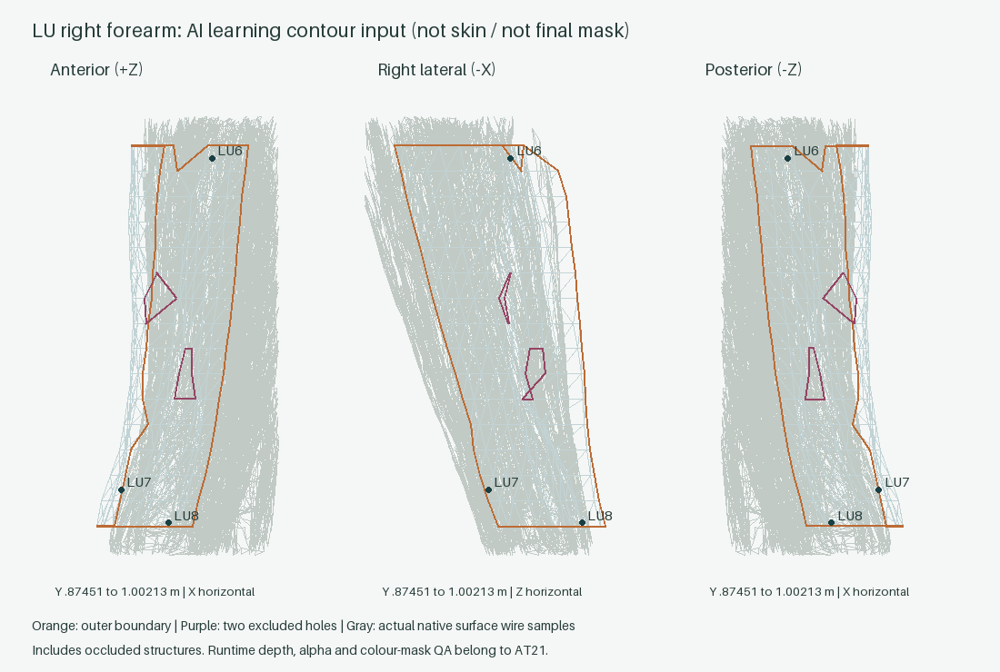

# AT20 — 14경맥 영역 근거·경계 입력 r1

2026-10-12. **AT20의 작업 경계와 인수 검사 통과.** 14경맥의 독립 원장과 오른쪽 폐경 아래팔 한 부분 영역의 실제 경계 입력을 작성했다. 최종 mask, 색 면 runtime, 다른 13개 완성 영역은 작성하지 않았다. AT21은 실행하지 않았다.

## 착수 조건과 소유 범위

- 시작 HEAD: `7d9bb2642906053faa2dda3704964dd5e0799b64`.
- 시작 index는 비어 있었고, 기존 변경은 5,966개(추적 WIP 45개, 미추적 5,921개)였다. NUL status 원문과 149개 보존 대상·45개 WIP SHA는 [baseline](../evidence/AT20/run-r1/baseline.json)에 있다.
- 최신 AT6 resume는 교육용 양측 실제 표시 22, 정밀 피부 위치 0, 교육용 미확정 0 및 acceptance=true였다. 최신 AT7도 acceptance=true였다. 실패했던 역사 AT6를 최신 성공 결과로 바꾸거나 부분 승인하지 않았다. 최신 report/validation/실제 learner SHA를 확인한 [조건부 실행 gate](../evidence/AT20/run-r1/predecessor-gate-r1.json)가 통과했으므로 진행했다.
- 읽은 실제 위치: `atlas-data/acupoints/learner/lung-r7.json` SHA `cac0de7048c443b36cfcfcb0c07443add241f1ab43bf5ac77badefeebd6bceee`. 14 projection group 안의 instance 합계가 22다. 원래 AI provenance·교수 미검토·공개 재배포 held는 유지했다.
- 소유: 새 `atlas-data/acupoints/territories/AT20-r1/`, 공통 offline `territoryBoundary.ts`와 관련 test, 이 report, `work/evidence/AT20/run-r1/`, EXECUTION의 AT20 record와 feature nextUnit. 원본, OpenSim_Models, T13 drafts, 기존 WIP, 역사 evidence 및 scene/UI/camera/point placement는 제외했다.

## 자료와 주장 범위

공적 자료는 경혈의 기준 구조·위치 관계와 경근/피부의 문헌 유형을 조사하는 데 사용했다. **어느 자료도 이 task의 색 면 polygon 외곽선을 확정한 자료로 취급하지 않았다.** 면 폭·분지 연결·전후측 강조 계획은 별도 AI 작성이다.

- [KMCRIC LU6](https://www.kmcric.com/database/acupoint/LU/LU6)와 [LU8](https://www.kmcric.com/database/acupoint/LU/LU8)의 앞가쪽 아래팔·요측 손목 관계를 폐경 표본의 위치 지표로 사용했다. 실제 구조 주소는 AT6의 WHO 위치 관계 및 native annotation에서 재사용했다. 근육/뼈 관찰을 노동맥이나 피부 주름의 실제 관찰로 바꾸지 않았다.
- [靈樞 經筋 Chinese parallel incipits](https://ctext.org/text.pl?node=81198&if=en&show=parallel)의 12경근 시작·결절 관계를 읽었다. 전체 장 직접 fetch는 403이었으며, 전체 분지 독해나 현대 근육 일대일 대응을 완료했다고 주장하지 않는다. 번역문은 사용하지 않았다.
- [素問 皮部論](https://ctext.org/huangdi-neijing/pi-bu-lun/zh), [骨空論](https://ctext.org/huangdi-neijing/gu-kong-lun/zh)은 primary Chinese 검색 passage를 읽었고 직접 open은 403이었다. 피부 분부와 임독맥 관계의 유형 근거이며 수치 외곽선 근거가 아니다.
- 확보 자료는 AT1 catalog와 AT6 WHO 2008/reprinted 2009 위치 관계 입력을 재사용했다. atlas-data/work의 PDF/EPUB/DOCX 조사에서는 추가 사용자 경혈 교재가 없었다. 현재 scoped cache의 WHO 원본 PDF도 없으며 재다운로드하지 않았다. 교수 교재·피드백과 첨부 사진은 이번 요청에 제공되지 않았다. 사진의 허용 역할은 색 표현 참고뿐이다.
- KMCRIC의 권리 고지는 All Rights Reserved다. 짧은 출처 명시 사실 요약만 작성했으며 원문·그림의 공개 재배포를 승인하지 않았다. 고전 digital edition 재배포도 held다. ZA/BP3D carrier 출처 권리, 위치 검증, AI 작성, 교수 검토, 공개 재배포를 독립 기록했다.

18개 source의 주소·판본/locator·읽은 범위·실패/대안은 [source register](../evidence/AT20/run-r1/source-register-r1.json), 교재 조사 범위는 [inventory](../evidence/AT20/run-r1/acquired-material-inventory-r1.json)에 있다. CV17 fetch 실패에는 읽힌 CV12를 사용했다. 실패한 URL을 반복 다운로드하지 않았다.

## 14경맥 정의

[definitions-r1.json](../../atlas-data/acupoints/territories/AT20-r1/definitions-r1.json)은 각 경맥의 전/후/측면 candidate 지표, 분지 정책, 경계 작성 규칙, 지원 carrier와 정확한 불확실성을 고정한다. 아래 표의 지표는 점 위치의 자료 근거이고, 넓은 면 계획은 AI 초안이다.

| 경맥 | 확인한 자료 지표 | 면·분지의 구체적 미확정 |
|---|---|---|
| LU 수태음폐경 | LU6 앞가쪽 아래팔, LU8 요측 손목 | 본 표본 밖 흉부/위팔/손목/엄지, 검지 분지 및 경근 흉부·횡격막 관계의 면 연결 |
| LI 수양명대장경 | [LI15](https://www.kmcric.com/database/acupoint/LI/LI15) 어깨봉우리–큰결절 | 팔/얼굴 폭, 입 주변 좌우 교차와 어깨 앞뒤 분리 |
| ST 족양명위경 | [ST36](https://www.kmcric.com/database/acupoint/ST/ST36) 정강이 앞·앞정강근 | 얼굴·목 분지와 흉복부/하지 면 폭 |
| SP 족태음비경 | [SP9](https://www.kmcric.com/database/acupoint/SP/SP9) 정강뼈 안쪽관절융기 | 안쪽 다리–가슴 연결 폭 및 LR/KI 겹침 |
| HT 수소음심경 | [HT3](https://www.kmcric.com/database/acupoint/HT/HT3) 팔꿈치 앞안쪽·안쪽위관절융기 | PC/SI와 팔 안쪽 면 분할, 실제 주름이 없는 정지 모형의 지표 |
| SI 수태양소장경 | [SI11](https://www.kmcric.com/database/acupoint/SI/SI11) 어깨뼈가시–아래각 | 어깨뼈 범위와 귀·얼굴 분지 폭 |
| BL 족태양방광경 | [BL40](https://www.kmcric.com/database/acupoint/BL/BL40) 오금·힘줄 사이 | 척추 양옆 두 줄의 안팎 폭, 후두·둔부 합류 |
| KI 족소음신경 | [KI3](https://www.kmcric.com/database/acupoint/KI/KI3) 안쪽복사–발꿈치힘줄 | 발바닥 피부 결손/접근, 내부 주행과 외피 구간 분리 |
| PC 수궐음심포경 | [PC7](https://www.kmcric.com/database/acupoint/PC/PC7) 손바닥쪽 두 힘줄 사이 | HT/LU 사이 폭, 손바닥·가슴 분지 |
| TE 수소양삼초경 | [TE5](https://www.kmcric.com/database/acupoint/TE/TE5) 아래팔 뒤 노뼈–자뼈 사이 | 손등–귀/얼굴 분지, 앞뒤 점 사이의 관통 면 금지 |
| GB 족소양담경 | [GB34](https://www.kmcric.com/database/acupoint/GB/GB34) 종아리뼈머리 앞·먼쪽 | 머리 교차/분지 독립 경계, 옆몸통·둔부·가쪽 다리 폭 |
| LR 족궐음간경 | [LR3](https://www.kmcric.com/database/acupoint/LR/LR3) 첫째–둘째 발허리뼈 | 서혜·외생식·내행과 외피 구간 분리, 회음 결손의 대체 금지 |
| CV 임맥 | [CV12](https://www.kmcric.com/database/acupoint/CV/CV12) 앞정중 배 | 정중 강조 폭, 회음/구강 지원 결손과 전통 분지 |
| GV 독맥 | [GV14](https://www.kmcric.com/database/acupoint/GV/GV14) 뒤정중 C7 아래 | 뒤정중/두피 폭, 잇몸·소대 지원 결손과 전통 분지 |

각 원장은 `surface_learning_connection`, `sinew_projection`, `cutaneous`, `professor_interpretation`을 분리한다. 12경근은 incipit만 기록하고 mask는 0이다. CV/GV의 경근 상태는 `not_applicable`이며 13/14번째 경근으로 추가하지 않는다. 교수 해석은 `not_supplied`, 교수 검토는 `not_performed`, 확정 피부 경계는 0이다. 빈 posterior/anterior 계획은 부재의 증명이 아니다. 내행을 외피에 투사하지 않고, 분지/겹침은 독립 유지하며 표면 결손을 다른 신체 구역으로 옮기지 않는다.

## 실제 폐경 control boundary

[lung-forearm-right-boundary-r1.json](../../atlas-data/acupoints/territories/AT20-r1/lung-forearm-right-boundary-r1.json)은 현재 `education-r1/arm-right-0`의 실제 경계다. 피부 스캔이 아닌 native-derived 교육용 envelope다.

- frame `HUMAN_ATLAS_RH_M_XLEFT_YHEAD_ZANTERIOR`, 단위 m, 정지 pose `ZA-9f08a17ea0115fed-frame0-autoexec-off`, subject-right(X 음수), 실제 manifest/binary/topology SHA를 고정했다.
- native 팔오금 endpoint, 요골 수근 endpoint, APL/EPB 힘줄 구간, radial styloid 문맥의 주소 4개를 AT6 원문 입력 SHA/locator와 함께 재사용·replay했다. 65개의 boundary control도 실제 carrier triangle+barycentric 및 native support 주소로 읽었다.
- AT3 실제 grid ring 1–16, angular index 0–12를 선택했다. **108도 폭은 AI 학습 창의 작성 값**이며 경맥/경근/피부의 문헌 폭이 아니다. LU6·LU7·LU8의 독립 검증 교육용 위치를 포함한다.
- Y 범위는 0.874507964–1.002126932m다. 근위 ring17의 vertex680/angular3 pinch 앞에서 멈췄다. 원위는 wrist-link seam 앞에서 멈췄다. 결손 두 곳을 hole로 유지했다.
- 실제 closed outer 55 + hole 6 + hole 4 = **65 controls / 3 loops**, seed triangle1174. barrier adjacency replay는 **351 faces**와 고정 face-set SHA로 재현됐다. 최종 triangle mask/weight/새 geometry는 export하지 않았다.
- 351 faces와 주변 원본 ZA bone/muscle/fascia 24개에 대한 proper triangle intersection은 **0**이다. 이 검사는 피부 정밀도나 확정 경근 경계를 증명하지 않는다. landmark 4개와 읽은 native source SHA는 [surface inspection](../evidence/AT20/run-r1/surface-inspection-r1.json)에 있다.
- 왼쪽 contour는 아직 작성하지 않았다. mirror를 실제 좌측 검증으로 세지 않는다. LU1–5/LU9–11은 유효한 기존 점이며 이 부분 표본 밖이다.

위 이미지는 실제 source wire와 control의 과학적 검사 그림이며 learner 색 면 renderer의 화면이 아니다. 보이는 source wire에는 가려진 구조도 포함된다.

## 공통 계약·검사·실제 화면

공통 offline [territoryBoundary.ts](../../atlas-web/src/viewer/acupoints/territoryBoundary.ts)는 기존 Territory 어휘/anchorAdapter의 frame/unit/pose/side/rights/hash 검사를 재사용한다. 타입 분리·provenance·closed neighbor loop·pinch/누락 hole·seed leakage를 검증한다. AT5 compiler 입력과 AT6 성공 위치를 그대로 읽는다. 새 compiler/overlay/tour/CameraSessions, runtime loader나 인체 복사본은 만들지 않았다. 앱 import 경로에 이 data/module을 추가하지 않았다.

- 관련 실제 carrier test **20개 통과**, fail0. stale context/hash, 잘못된 좌우/권리/유형/CV-GV 경근, source certainty 위장, 누락 hole, 외부 seed, unsupported chord, pinch, 이동 anchor 등을 검사했다.
- `tsc -b --pretty false` 성공. 전체 역사 suite와 13단계 package build는 이번 task에서 반복하지 않았다.
- 실제 동일 scene/root/renderer에서 **LU6/LU7/LU8 오른쪽 × 390/1024/1440 =9 화면**을 기존 learner 카드·점·기준 구조로 확인했다. 선택 label 하나, 점 가림 없음, 패널을 제외한 observation 내부, occupancy 0.606–0.629였다. 390 화면의 카드가 스크롤되는 기존 동작을 유지했다. 이번 task의 색 면/회전 compositing 검사는 AT21에 남는다.
- 최초 snapshot 두 건은 deferred camera 시작 전의 데이터를 읽었다. 최종 1024 LU6는 r3로 재촬영하고 camera target 일치를 확인했다. 초기 evidence는 보존하되 합격 수에는 넣지 않았다. [최종 9건 목록](../evidence/AT20/run-r1/actual-screen-cases-final-r3.json)이 유효 목록이다.
- 종료 시 원래 URL·선택·layer·camera/target를 복구했다. camera/target 오차0, scene root 동일, geometry buffer 6,947,334 bytes 동일, cameraOwner=null, registeredUpdates=0. 콘솔 기록은 오류0이다.
- 검사 도구의 초기 Matplotlib 부재에는 NumPy/Pillow/SVG로 evidence 그림을 작성했다. 초기 순서 의존 acceptance assertion은 LU6/7/8 집합 비교로 수정했다. 실패 로그는 그대로 남겼다. 제품 데이터 상태를 바꿔 통과시키지 않았다.

[validation-r1.json](../evidence/AT20/run-r1/validation-r1.json), `tests-final-r2.log`, `typecheck-final-r1.log`, `surface-inspection-final-r3.log`, `validation-final-r3.log`가 최종 관련 검증이다. 성공 위치 22와 정밀 위치0, 교수 검토0, 공개 재배포 가능0, fixture export0은 그대로다.

## 비용·보존·남은 범위

AT20 추가 runtime bytes/triangles/GPU buffers/draw calls는 **모두0**이다. offline JSON은 definitions 64,048 bytes, boundary 56,461 bytes다. 공유 carrier는 기존 40,896 encoded bytes /2,188 triangles다. 351개 face ID+float32 weight의 향후 compact CPU 저장 추정은 2,808 bytes이며 실제 AT21 GPU 비용 측정이 아니다. driver VRAM은 측정하지 않았다. 기존 20MiB overview/96MiB geometry/1M triangles/8MiB chunk 예산은 변경하지 않았다.

149개 frozen hash와 기존 추적 WIP45개는 그대로다. baseline 미추적 변경도 선별 커밋에서 제외했다. EXECUTION은 최신 내용을 다시 읽어 AT20 record와 `featurePlans.acupoint-at-361.nextUnit`만 갱신했다. `sync_execution.py`는 **Updated 0 execution views**, `--check`는 **Execution projections match; no writes**였다. 의미 diff는 [execution-update-r1.json](../evidence/AT20/run-r1/execution-update-r1.json)에 있다. 로컬 커밋 포함 목록과 실제 hash는 Git/final 전달값에서 확인한다; 자기 commit hash를 산출물 내부에 추정 기록하지 않는다.

**AT20 남은 unit은0**이다. 이는 명세의 한 부분 LU 실행 입력과 13개 근거/불확실성 원장 완료다. 양측 전체 LU 면, 다른13개 mask, 완전한 경근 분지/현대근 대응, 정밀 피부 경계, 교재·교수 해석 및 공개 재배포 완료를 뜻하지 않는다. [remaining-units-r1.json](../evidence/AT20/run-r1/remaining-units-r1.json)에 범위를 분리했다.

다음 order는 **AT21**, 선행은 AT4/AT7/AT20이다. 다음 task에서는 이 오른쪽 아래팔 입력을 먼저 재현하고, 동일 국소 landmark/carrier를 실제 왼쪽에서 독립 작성·검증하여 양측 학습용 면을 연결해야 한다. 반사 좌표를 좌측 검증으로 대체하지 않는다. 렌더러/가림/깊이/alpha/G1–G8 검증은 다음 작업이며 자동 실행하지 않았다. [붙여 넣을 다음 프롬프트](../evidence/AT20/run-r1/next-prompt-AT21.txt).

push·배포·진단·치료·침 시뮬레이션은 수행하지 않았다.
