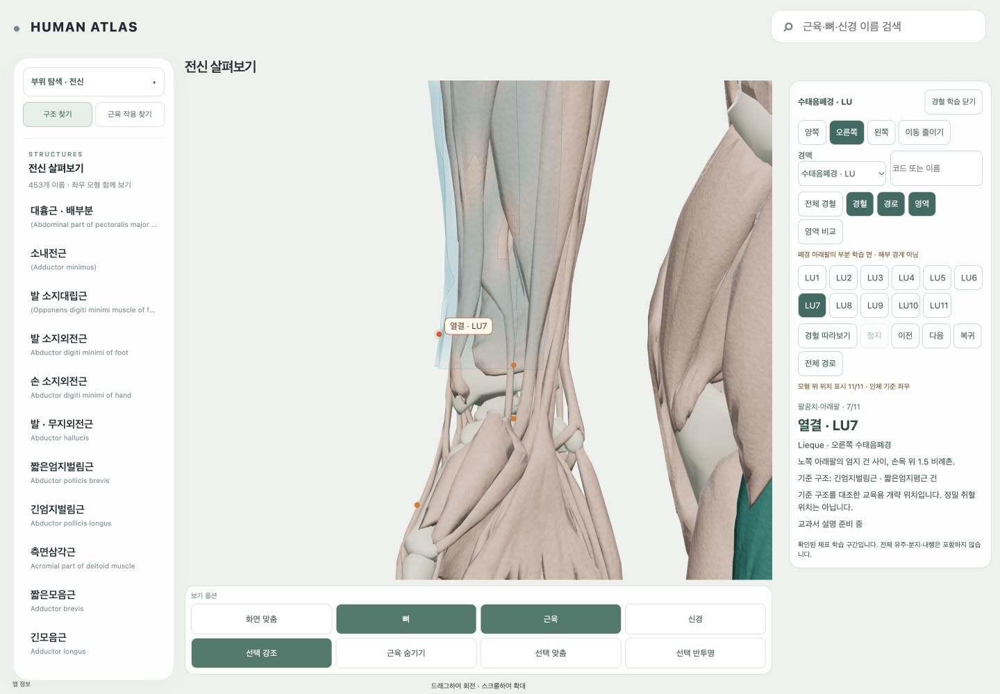

# AT21 — 같은 체표에 붙는 부분 학습 면

2026-10-12. **AT21 작업 경계 완료, acceptancePassed=true.** 기존 AcupunctureOverlay 안에 공유 carrier triangle mask/vertex weight 렌더링을 연결했다. 실제 데이터는 **폐경 아래팔 한 부분 영역의 양측 mask 2개**이며 전체 폐경·14개 완성 영역·확정 경근/피부 경계로 세지 않는다. AT22는 실행하지 않았다.

## 시작·선행·소유

시작 HEAD `d9cd46f31d1613f3337b764fbc8b64a31de3d1f6`, index empty, 기존 status 5,966개(추적 WIP45 / 미추적5,921). 시작 SHA·NUL status·허용 소유 경계는 [baseline](../evidence/AT21/run-r1/baseline.json)에 있다. 최신 EXECUTION과 AT4 actual geometry/access, AT7 learner/camera, AT20 actual boundary/report/validation을 읽었다. AT6/AT7의 최신 성공과 실제 learner hash, AT20의 351-face 입력이 있으므로 착수했다. 역사 AT6 실패와 현재 합격을 혼합하지 않았다.

소유 변경은 공통 schema/territoryBoundary/territoryMask, 기존 AcupunctureOverlay/AcupointReview, 관련 tests/DEV compositing helper, 새 compact mask package, 이 report/evidence 및 EXECUTION의 AT21 record와 feature nextUnit뿐이다. CameraSessions/PointTour/anchor compiler/adapter/carrier binary/경혈 좌표/원본/OpenSim_Models/T13/기존 WIP/보기옵션·홈·로딩은 보존했다.

## 실제 양측 입력과 공통 renderer

- [제품 masks.json](../../atlas-data/acupoints/territories/lung-r1/masks.json): 위치 배열 없는 compact 입력 10,600 bytes, Right/Left 각351 faces, 총702. 기존 source/AI/professor/public 상태를 보존한다.
- 오른쪽은 AT20의 outer55 + holes6/4, 65 controls, seed1174를 기존 공통 barrier traversal에서 재현했다. AT20 원문 입력을 변경하지 않았다.
- 왼쪽은 actual `arm-left-0` 및 AT6 좌측 팔오금/요골 수근/APL/EPB source 주소4개에서 작성했다. grid angles28–39 plus0, ring1–16은 AI의 앞/요측 학습 창이다. 실제 outer55 + holes7/5, **67 controls**, seed1246이며 오른쪽 reflection이 아니다. 폭108도와 양끝은 문헌의 확정 경계가 아니다.
- frame `HUMAN_ATLAS_RH_M_XLEFT_YHEAD_ZANTERIOR`, m, `ZA-9f08a17ea0115fed-frame0-autoexec-off` 및 현재 binary/topology/source SHA를 대조했다. 양측8 native annotation과132 controls를 actual source에서 읽고 검증했다. 각351 faces/주변 native24개를 검사한 proper native triangle intersection은0이다. closed-volume containment/접선 전수 검사나 정밀 피부 위치의 증명은 아니다.
- `replayTerritoryBoundary`는 AT20 validator와 같은 검사/adjacency traversal을 공유한다. 기존 non-exporting validator API도 유지한다. 새 point compiler·scene·renderer·인체 복사본은 없다.
- 새 `TerritoryMask`는 기존 Territory 어휘를 확장한다. 독립 frame/pose/side/carrier/boundary/content hash, authorship·권리·precision·scope를 검증한다. Source polygons와 AI 학습 폭을 합치지 않는다.
- position/normal BufferAttribute를 canonical carrier와 공유하고, mask index/visual weight/outline buffer만 별도 생성한다. alpha0.27, 경계 feather .22/.65/1, depth test ON, depth write OFF, 작은 polygon offset, 고정 draw order와 선택 영역 우선 강조를 쓴다. 14경맥의 색은 표시 값이다. 실제 13개 추가 영역을 생성하지 않았다.
- 영역 raycast는 비활성이다. 실제 색 면 아래 클릭이 기존 오른쪽 **위팔노근** source 선택으로 연결됐고 overlay가 종료됐다. 실제 LU8 점 클릭은 `kind=acupoint, code=LU8, side=right`를 선택하며 URL의 anatomy source ID를 바꾸지 않았다.
- 기존 `영역` 버튼과 간단한 `영역 비교`만 활성화했다. 면은 사용자 ON/OFF·side/channel 전환 상태를 유지한다. 선택 경맥의 mask가 없으면 만들지 않으며 비교에서 확인된 LU 면만 보여준다. 전체 비교 최종 UI/14색 범례는 AT26 범위다. 모바일에도 부분 학습 면 안내를 유지했다.

## 취소·자원·카메라 수정

영역 모듈/compact JSON은 ON 시 lazy import/fetch한다. signal과 generation/dead guard가 로딩 중 OFF/side 변경/종료 뒤 늦은 allocation·reattach를 막는다. OFF는 동기 해제하며 data·weight/index/outline·material을 놓는다. 숨긴 canonical mesh가 WebGL dispose listener를 등록하지 않았을 때도 공유 vertex buffer를 해제하고 base VAO를 무효화하도록 보완했다. CPU carrier attribute/좌표/topology는 유지하며 다음 ON에 재업로드한다.

화면/빠른 선택 중 이미 충분한 구도로 판정한 경우, 이전 tween과 작은 OrbitControls 잔여 damping이 이어질 수 있었다. 공통 관찰 함수에서 **현재 구도를 비애니메이션으로 재적용해 damping을 flush**하고 이전 이동을 종료했다. 죽은/foreign-camera 세션의 관찰 요청은 무시한다. 기존 CameraSessions의 단일 복귀값·수동 입력 우선·reduced motion 정책과 서비스를 재사용했다. LU별 거리 또는 별도 카메라를 추가하지 않았다.

## 관련 검사와 실제 화면

| 계약 | 실제/자동 검사 | 결과 |
|---|---|---|
| G1 | 현재 원래 source/selection/layers에서 진입·동일 root/camera 및 정확한 닫기 | pass |
| G2 | LU6/7/8 양측 ×390/1024/1440 **18개** 점·선·면·카드 화면; LU1/9/11 양측390 **6개** 기존 문맥; 실제 점 클릭 | pass |
| G3 | 실제 tour 중 drag/방향키 중단, paused/autoReturn=false; pointer/touch contact·wheel 공유 경로의 관련 검사 | pass; 물리 터치 장치 미사용 |
| G4 | 3회 ON/OFF, 빠른 OFF/side, 마지막 right만 적용; slow import/fetch/late completion 자동 검사; 충분한 구도의 이전 tween/damping 및 foreign owner | pass |
| G5 | 모바일 card 접힘/펼침·44px 기존 목표, 실제 점·구조가 패널 밖 가시 영역 | pass |
| G6 | reduced motion에서 transition=false, Enter로 영역 OFF/ON, 실제 위팔노근 클릭; 닫기 후 원래 source와 native 자원 | pass |
| G7 | 양측 정면/사선/뒤 actual ON/OFF **6쌍**; body depth 가림·radial rim·hole 유지, 점/면이 같은 몸에 붙음 | pass |
| G8 | DEV **2 overlapping masks** 합성/회전/빠른 OFF; density revision 교체에서 camera error0, point world·carrier hash 불변, mask hash만 변화 | pass for renderer/reload contract; brush/editor는 AT22 |

관련 tests **66/66 pass**, TypeScript 및 package build **13/13 단계 pass**. 전체 역사 suite는 반복하지 않았다. `build-owned.py`는 원래 package command의 검사를 isolated output에서 실행하고 distribution checker의 output root만 메모리에서 대체했다. 기존 dist와 WIP는 건드리지 않았다. build의 기존 큰 chunk warning은 남겼으며 threshold를 올리지 않았다.

주 시각 기록은 `responsive-cases-final-r7.json`, `existing-context-cases-final-r6.json`, `rotation-cases-final-r5.json`, `resource-cycles-final-r7.json`이다. 카메라 수정 후 `final-code-screen-check-r11.json`, actual point/native pick와 `final-return-r11.json`을 추가했다. 변경은 좌표를 바꾸지 않고 수명/카메라/오류 안내를 보완했으며 이전 증거는 덮지 않았다. DEV는 `DEV-compositing-revision-qa-r10.json`이며 제품 실위치/영역 수에 포함하지 않는다.

초기 camera 진단은 renderer report 갱신이 늦어 ON/OFF 숫자가 달랐다. 갱신된 currentCamera 버전의 실제6쌍에서는 최대 position 오차2.1e-15m, target 오차0이다. 최초 검사 tool의 Node strip-types/NumPy 환경 및 좌측 audit locator 오류는 수정했고 실패 로그는 보존했다. 브라우저 자동 승인 timeout은 허용된1회 retry로 복구했다. 종료된 tab/이전 핸들과 HMR로 새로 생긴 UUID를 하나의 scene으로 합산하지 않았다. Source list로 복원한 첫 Rectus 선택은 left로 잡혀 그 기록을 복귀 합격으로 세지 않았고, 최종 원래 right source로 확인했다.

최종 원래 source `ZA-c7010a9-eb0a993e09d73159468116ce`, layer/selection/camera/target를 복원했다. 해당 세션 root 동일, camera/target error0, owner=null, registeredUpdates0, native geometry array6,947,334 bytes, overlay/label/territory 제거. console warn/error0. actual screen/동작과 shader/resource 검사를 분리한 판정은 [validation](../evidence/AT21/run-r1/validation-final-r1.json)에 있다.

## 비용과 한계

| 포함 비용 | 오른쪽 | 왼쪽 | 양측 |
|---|---:|---:|---:|
| mask-owned index/weight/outline 배열 | 6,994 | 7,006 | 14,000 bytes |
| 공유 carrier position/normal 배열 | 27,768 | 27,792 | 55,560 bytes |
| 실제 mask draw에 사용하는 unique 배열 용량 | 34,762 | 34,798 | 69,560 bytes |
| 추가 mask triangles / draw calls | 351 /2 | 351 /2 | 702 /4 |

기존 canonical geometry 배열/encoded chunk는 right40,896 bytes/2,188 triangles, left40,914 bytes/2,187 triangles다. 이미 예산에 포함한 숨김 carrier가 영역 ON에서 처음 vertex buffer를 업로드할 수 있으므로 새 index/weight 14KB만 GPU 전체 비용이라고 주장하지 않는다. **위 수치는 GPU용 배열 용량/호출 계수이며 driver VRAM 실측이 아니다.** shader texture0, deferred mask module6,920 bytes, compact JSON10,600 bytes다.

양측22점/carrier/route/context/catalog/mask를 포함한 encoded data642,421 bytes, geometry 배열367,464 bytes, 할당 triangles20,954, carrier OFF 최대 draw28이다. right ON/OFF의 배열187,790→180,796 bytes, renderer geometry403→401가3회 반복됐다. 전체 종료에는 native6,947,334 bytes로 돌아왔다. 기존 native overview17,437,548 bytes를 포함해20MiB/96MiB/1M triangles/8MiB chunk 예산 안이며 예산 파일은 변경하지 않았다. source frame/hash가 다른 표면에는 자동 적용하지 않는다.

정밀 피부 위치0, 교육용 위치22, 새 point approval0, 교수 검토0, 공개 재배포 가능0은 그대로다. 혈의 치료 반경·경근 전체 해부 모델·확정 피부분절을 만들지 않았다. 원래22개 성공 위치는 mask와 독립 유지했다.

## 보존·다음

시작 hash 원장152개 중 명시적 AT21 소유 code3개(schema/overlay/review)의 before/after를 별도 기록했다. 나머지 **149 frozen hash와45 WIP hash**는 동일하다. [보존 판정](../evidence/AT21/run-r1/preservation-final-r1.json)은 이를 혼동하지 않는다. 기존5,966 status 항목과 원본/OpenSim/T13/역사 evidence·선행 JSON/carrier/point data는 선별 commit에서 제외했다.

최신 EXECUTION을 다시 읽고 AT21 record와 feature nextUnit만 갱신했다. sync_execution.py는 Updated0 execution views, --check는 Execution projections match; no writes였다. 소유 목록과 최종 commit hash·제외/잔여는 Git 기록 및 완료 답변에 남긴다. isolated build-output은 Git에서 제외했고 작업 중 만든 임시 브라우저 탭은 정리했다.

**AT21 remaining unit0.** 다음은 order/선행을 대조한 **AT22**다. brush/지우기/undo/redo/revision 저장, 다른13개 실제 영역 및 전체LU 확장/정밀 피부/교수/교재/공개 권리는 이 task 완료 수에 섞지 않는다. [다음 프롬프트](../evidence/AT21/run-r1/next-prompt-AT22.txt)를 남기고 자동 실행하지 않는다. push·배포·진단·치료·침 시뮬레이션은 수행하지 않았다.
