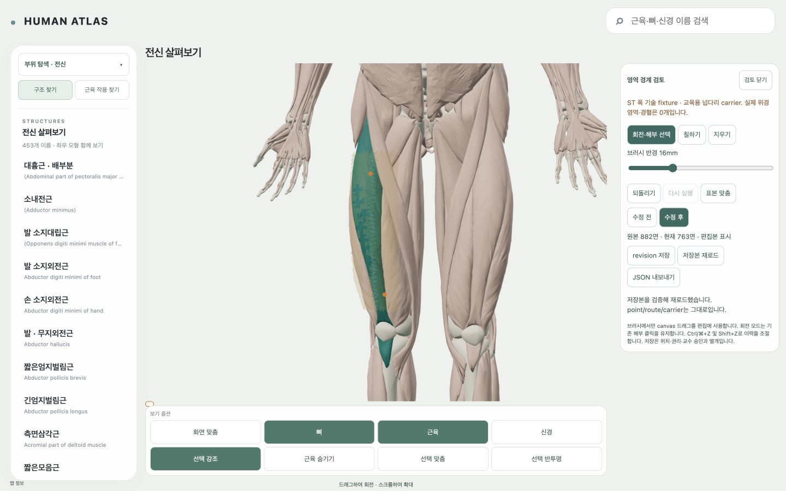

# AT22 — 공통 체표 triangle mask 검토 편집

2026-10-12. **AT22 작업 경계 완료, acceptancePassed=true.** 개발 review에서 기존 canonical carrier 위의 triangle brush/지우기/undo·redo, 같은 카메라의 수정 전후 비교, 브라우저 revision 저장·재로드·JSON export를 연결했다. 실제 드래그로 **ST 폭 기술 fixture 882→763면**, 119면을 지웠다. 점·비어 있지 않은 연결선·carrier hash 및 비교 camera 오차는 모두 불변/0이다. **실제 위경 영역과 새 경혈 승인은 각각 0**이다. AT8은 실행하지 않았다.

## 시작·입력·소유 경계

시작 HEAD `e77e7e4dc295e8ba627e5860f361c514154609da`, 기존 status **5,966개(추적 WIP45 / 미추적5,921)**, index empty. 시작 NUL status, 45개 WIP hash, EXECUTION 원문 snapshot과 소유 경계는 [baseline](../evidence/AT22/run-r1/baseline.json)에 있다. AGENTS, 최신 EXECUTION/NEXT, AT22 명세, 30/31 설계 및 실제 AT21 mask·화면·validation을 확인했다. AT21의 최신 acceptance=true와 351면×양측 실제 부분 LU 입력을 재사용했다. AT3/4 carrier manifest/geometry/access, AT5 compiler 계약 및 AC1/AC2 schema/anchor/CameraSessions/tour의 재사용 경계를 대조했다. 완료한 MV1/AT 전수 조사는 반복하지 않았다.

소유 code는 기존 main/WholeBodyViewer/AcupointEntry의 DEV 진입, AcupunctureOverlay의 공통 mask revision 교체, territoryMask의 명시적 fixture 검증 옵션, 관련 lifecycle test와 새 triangle editor/model/fixture/controller/DEV panel/CSS/test다. 소유 기록은 이 report/evidence와 EXECUTION의 **AT22 record 및 feature nextUnit**뿐이다. 기존 point compiler/anchorAdapter/CameraSessions/tour/AcupointReview, 좌표·경로·carrier binary·MV2 자산·원본/OpenSim/T13/사용자 WIP 및 보기옵션·홈·로딩은 수정하지 않았다.

## 한 편집 경로와 실제 표본

DEV URL은 `/review?territories=1&source=ZA-c7010a9-eb0a993e09d73159468116ce`, 기존 화면의 **영역 경계 검토** 진입이다. 별도 ReviewApp scene을 만들지 않고 기존 App의 DatasetSceneAdapter/AnatomySceneRoot/camera/renderer에 연결한다. flag가 없는 기존 `/review` 및 일반 learner 진입은 보존한다. 패널은 기존 review 배치·모바일 접기/스크롤 규칙을 사용한다.

- 기존 `education-r1/manifest.json`의 오른쪽 **leg-right-1**을 공통 abortable carrier loader로 읽었다. topology SHA `b6df81071229611d80bba8e01cb8cb865aefbdb6a4801f131ffa6f4cc931dcc9`, 2,808 vertices /5,394 triangles /99,756 encoded bytes다. frame `HUMAN_ATLAS_RH_M_XLEFT_YHEAD_ZANTERIOR`, m, pose `ZA-9f08a17ea0115fed-frame0-autoexec-off`와 현재 dataset revision을 검증한다.
- 표본은 현재 carrier 앞면의 명시적 범위로 작성한 **882개 triangle 기술 띠**다. 이 bounds 규칙은 위경의 해부학적 폭/문헌 경계/혈위 규칙이 아니다. 원본 기반 교육용 envelope이며 피부 스캔·닫힌 전신 피부로 주장하지 않는다. 원래 carrier geometry/좌표/권리는 그대로다.
- 두 **PROBE**는 고정 triangle+barycentric 주소를 공통 anchor adapter에서 읽는 미확정 기술 지점이다. 실제 ST 혈위로 승인하거나 learner bundle에 내보내지 않는다. 관찰 가능한 불변 연결선은 888개 coordinate 값(296 positions/148 segments)을 갖는 기술 surface line이며 전통 유주가 아니다.
- point SHA `7c1976d6f32f0be5a9a324de8e5a88a927ee24d5a6e2832ac6dbdea3cdeb1820`, route SHA `aa5b9ce154b2bbc1b74baa5baf9106a27157662bc9b23007708e0b7f75814014`를 원본 mask와 revision에 묶었다. 현재 LU learner 좌표/경로 및 AT21 실제 LU mask 입력을 편집한 것이 아니다.

편집기는 edge adjacency와 face-centroid 경로 거리로 브러시를 확장한다. 공간적으로 겹쳐도 연결되지 않은 component에는 번지지 않는다. 6–40mm는 기술 브러시 반경이며 치료/혈위 영역의 크기가 아니다. **triangle brush 하나**만 있고 UV paint, 경계 control-point editor, 조형 툴은 없다. 한 드래그가 한 atomic stroke다. pointer cancel/모드 전환은 미완 stroke를 원복하고 undo/redo 및 새 분기의 redo 취소를 제공한다.

명시적 칠하기/지우기에서만 canvas pointer를 capture해 기존 orbit/해부 클릭과 충돌하지 않게 한다. 기본 도구는 회전·해부 선택이다. 원본 비교에서는 shortcut도 편집을 하지 않는다. mask renderer는 기존 index/weight/outline 경로를 그대로 사용하며 공유 carrier position/normal 배열을 복사하지 않는다. revision 교체는 공통 generation/budget/disposal 경로이고 **camera 명령을 호출하지 않는다**. 표본 맞춤만 기존 ObservationContext 관찰 함수를 사용한다. AT7 거리·정책·연출과 기존 reduced-motion 경로를 바꾸지 않았다.

## 저장·검증·취소

revision은 `development_review_only`, `triangle_mask_revision`, 원본 content SHA, carrier/point/route SHA 및 독립 mask revision을 포함한다. 저장·export 시 진행 중 stroke와 비동기 편집 drift를 거부한다. 재로드는 schema/원본/side/frame/unit/pose/hash/local rights/topology/weight/content를 검사한 뒤 적용한다. mask 영역/revision 외 provenance와 권리를 바꾸는 저장본, stale binding, 잘못된 face 및 reviewApproval 승격을 거부하며 성공한 현재 mask를 보존한다.

AI author와 `ai_proposal`, `professorReview=not_performed`, `publicRedistribution=held`, `canonicalBoundaryClaim=false`를 유지했다. operator는 `unassigned_review_operator`, reviewApproval=false이며 저장 행위를 교수/사람 승인으로 기록하지 않는다. 원래 mask는 immutable clone으로 보존한다. localStorage의 한 검토 key에 최신 revision을 저장하며 export로 파일을 남긴다. 서버/제품 데이터에 자동 적용하지 않는다. 원본 비교·undo/redo·재로드에 content 기반 revision을 사용해 같은 면 집합을 정확히 재현한다.

모듈은 DEV 진입 뒤 lazy load, carrier는 요청한 chunk 하나만 읽는다. 닫기·source 선택·motion 시작·document 비활성화는 abort/generation/dead guard와 기존 overlay 종료 경로를 사용한다. 늦은 완료가 layer/camera를 다시 붙이지 않는다. resource 재생성은 mask-owned buffer뿐이며 OFF 뒤 shared update0/owner=null/기존 native geometry array 6,947,334 bytes로 돌아왔다. 저장본 오류/빈 mask는 자동 승인하지 않는다. empty mask는 미리보기와 undo가 가능하지만 저장/export는 유효한 비어 있지 않은 mask에서만 가능하다.

## 실제 인수와 관련 검사

| 검사 | 결과·실제 evidence |
|---|---|
| 칠하기/지우기 | 실제 drag로 882→763, paint로 882 복원. 두 PROBE와 비어 있지 않은 line의 좌표/hash 불변 |
| undo/redo | 버튼으로 한 stroke 복원/재실행, canvas Ctrl/⌘+Z·Shift+Z도 763/882 재현; 원본 비교 중 shortcut 무효 |
| G8 전후 비교 | 1280 및 최종 **1440×900** 동일 camera/root/point screens. 882/763 face 교체만 발생, camera/target 오차0 |
| 저장/재로드/export | 763면 저장→paint로882→재로드763. 새 세션에서도 동일 content/revision. 실제 download JSON을 별도 공통 validator/model에서 재생 |
| 390/1024/1440 | **390×844 /1024×768 /1440×900** 모두 표본 bounds가 safe viewport 내부, 두 PROBE frustum 내부. 모바일 버튼/slider 최소44px, 스크롤로 저장 도구 접근, 접기 작동 |
| 회전·가림·해부 클릭 | 실제 수동 orbit에서 몸과 면이 함께 회전, userMoved=true. 종료 후 수동 camera 그대로 유지. 색 면 위 클릭이 기존 오른쪽 **안쪽넓은근** 선택으로 이어지고 editor 종료 |
| 기존 상태 | 뼈 layer OFF로 진입·종료해 OFF/기존 카드/동일 root/camera 유지. 수동 입력 없는 최종 종료는 원래 camera/target로 정확히 복귀 |
| 빠른 OFF/해제 | 재로드/비교 빠른 전환 뒤 닫기, 늦은 module/fetch/replace의 자동 검사. mask·label·editor 제거, update0/owner=null/native bytes 복원 |
| 기존 learner | 일반 `/?territories=1`에서도 경혈 진입만 노출. 실제 **LU7** 카드/점/경로/351면 LU 부분 영역 동작, fixture0/editor없음 |
| bundle 격리 | production editor chunk0; 기술 ST id/브러시/저장/JSON revision/operator payload0. 실제 learner에 편집/export/review 메타데이터 없음 |

관련 tests **36/36**, TypeScript 및 기존 package build 검사 **13/13 단계** 통과했다. 전체 역사 suite를 재실행하지 않았다. isolated `build-output/r2`로 빌드해 기존 dist를 출력 대상으로 쓰지 않았다. 기존 large-chunk warning은 남겼고 threshold/예산을 올리지 않았다. 실제 browser warn/error0. 물리 터치 기기는 쓰지 않았으며 pointer 경로와 390 실제 화면/DOM 목표 크기를 검사했다. 새 OS reduced-motion 설정 변경은 하지 않았고 변경 없는 공통 정책의 선행 AT21 evidence를 재사용했다.

실제 캡처 **36장**과 관련 DOM 진단, [검증 원장](../evidence/AT22/run-r1/validation-final-r1.json), [실제 export](../evidence/AT22/run-r1/exported-ST-technical-revision-r1.json), 자동 test/build 로그를 남겼다. 화면 인수와 자동 처리는 별도 계수다. 1440 동일 camera의 canvas 읽기 전용 pixel 차이는 6,018 pixels이며 변경 bounds는 표본 면에 한정된다. 픽셀 분석은 해부 경계 검증이 아니다.

초기 실행의 strip-only Node는 parameter property를 처리하지 못해 transform-types로 검사한 최종 로그를 사용했다. HMR/닫힌 탭 뒤 새 세션을 만들었으며 UUID를 합쳐 단일 세션으로 세지 않았다. 새 탭의 viewport 초기화로 일부 `1440-r2` 파일명과 달리 JSON은 1280이다. 그 증거는 보존하고 **실측1440-r3**를 따로 남겼다. 최종 원장의 viewport assertion은 실제 innerWidth를 검사한다. 원본 비교 중 keyboard가 편집본 preview를 켤 가능성은 guard로 수정하고 실제 화면에서 확인했다.

## 비용·한계·보존·다음

| 포함 비용 | 원본882면 | 편집763면 |
|---|---:|---:|
| carrier/manifest/mask 포함 encoded | 208,899 | 208,256 bytes |
| 공유 carrier/점/경로/mask GPU용 배열 | 127,016 | 126,706 bytes |
| mask-owned index/weight/outline 배열 | 17,068 | 16,758 bytes |
| carrier 포함 할당 triangles | 6,660 | 6,541 |
| mask draw calls / carrier OFF overlay draw 최대 | 2 /6 | 2 /6 |

carrier chunk 99,756 bytes/5,394 triangles, route buffer 3,552 bytes를 포함한다. 20MiB overview /96MiB geometry /1M active triangles /8MiB chunk 기존 budget guard를 사용한다. 수치는 배열 용량과 draw 계수이며 **driver VRAM 실측이 아니다**. geometry 공유를 제외하고 작은 mask bytes만 총 GPU 비용이라고 주장하지 않는다. CPU edit history는 최대100 strokes이며 OFF에서 session 참조를 놓는다. 전체 새 피부/UV/전신 조형/14영역 생성은 없다.

원본/OpenSim393 files/T13 drafts13 files 및 carrier/point/route/AT21/MV2 공통 입력 등을 포함한 **소유 code4개/EXECUTION1개를 구분한 frozen 보호 hash1,269개**, 기존 **WIP45개**가 동일하다. 처음부터 보호 원본을 다시 생성하거나 수정하지 않았다. 소유 code6개는 시작 Git blob SHA와 따로 대조했다. 보호 hash는 소유 구현 뒤에도 수정하지 않은 입력에서 채취했으며 clean 공통 CameraSessions/compiler는 HEAD blob과 직접 대조했다. 기록된 hash 검사 범위와 원본 전체의 해부 조사 범위를 혼동하지 않는다.

최신 EXECUTION을 다시 읽고 AT22 record와 `featurePlans.acupoint-at-361.nextUnit=AT8`만 갱신했다. 기존 AT/MV/T/AC 및 숫자 NEXT/WIP를 보존하며 sync_execution.py는 Updated0 execution views, --check는 Execution projections match; no writes로 통과했다. 선별 commit 포함은 위 code12개/report/AT22 evidence/EXECUTION뿐이다. 원본·캐시·OpenSim·T13·기존45 WIP/5,921 미추적, isolated build-output/node_modules/download 원위치 파일은 제외한다. 최종 hash·잔여 status는 Git 기록과 완료 답변에 남긴다.

**AT22 remaining unit0.** 실제 ST 영역/혈위 검증은 이 기술 편집 표본의 완료 수에 포함하지 않는다. 다음은 최신 order 및 AT5/6/7/22 선행을 대조한 **AT8**이며 [붙여 넣을 프롬프트](../evidence/AT22/run-r1/next-prompt-AT8.txt)를 남겼다. AT8/다른 task/위임/push/배포/진단·치료·침 시뮬레이션은 실행하지 않았다.
