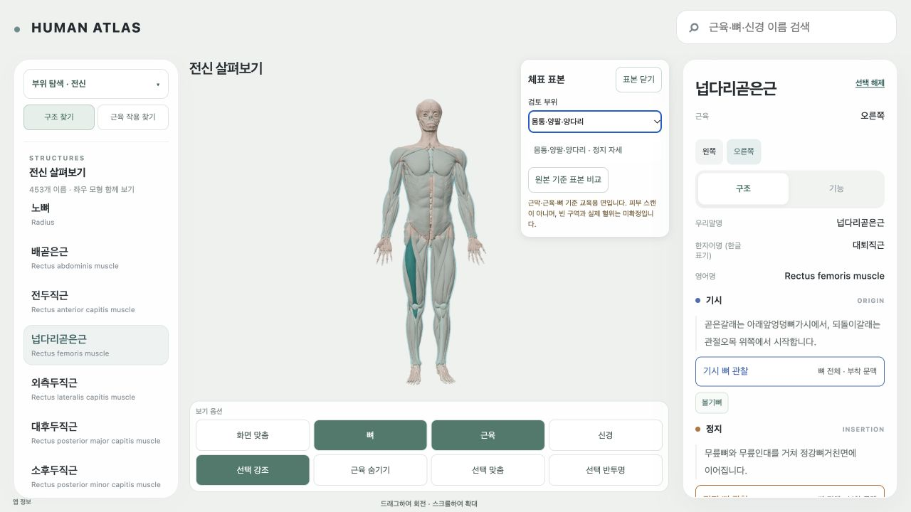

# AT3 — 몸통·팔·다리 공통 교육용 carrier

AT3의 부위별 생성/정합, 공통 manifest 등록, 정면·뒤·양측 검사와 기존 예산/장면 보존 기준을 완료했다. AT2가 채택한 native envelope 경로로 몸통 3개, 양팔 각 2개, 양다리 각 2개, 총 **11개 chunk**를 만들었다. 같은 AnatomySceneRoot에 표시하고 원본 기준 표본과 비교했다. 열린 경계와 제외 면이 있는 교육용 coarse carrier이며 전신 피부 스캔, 닫힌 피부 표면, 실제 혈위 승인으로 취급하지 않는다. 이번 point 작성/승인은 0개이고 기존 AC1/AC2 proposal을 변경하지 않았다.

AGENTS.md, 최신 EXECUTION/NEXT, AT3 명세, 30/31 설계, AT2 report/source-sample/native-ray-hits/validation/실제 화면을 확인했다. AC1 source-probe와 read-only `world()` reader, AC1/AC2 공통 schema/anchor adapter 및 기존 개발 진입을 재사용했다. 읽은 선행 파일의 hash는 `source-contract.json`에 있다. AC1 source의 skin/mucosa cache 부재를 재조사하거나 이미 조사한 자료를 다운로드하지 않았다. source 다운로드/수정은 모두 0이다.

공통 offline 생성기는 `atlas-web/scripts/buildEducationCarriers.py`, 공통 교차 index는 `nativeSurfaceIntersections.py`다. 역사 AC1 writer를 실행하지 않고 AST로 `world()` 함수만 읽는다. 부위 manifest는 `atlas-data/acupoints/carriers/education-r1/manifest.json`, 자료는 같은 폴더의 11개 little-endian binary다. 기존 `CarrierSampleOverlay`를 여러 chunk로 일반화했으며 새 renderer/인체 복사본/전역 camera manager를 만들지 않았다. 기존 AT2 단일 표본도 같은 검증/factory를 사용한다. 원본/source cache/기존 AC 자료/CameraSessions/tour는 수정하지 않았다.

| Source 계약 | 확인 값 |
|---|---|
| Revision | `c7010a903b75a2fd24a13b1c2c4c3546a9223780` |
| 원본 Blender SHA-256 | `9f08a17ea0115fed80b2a73ecdf0a1bc2ab2f6956f37c593ce23d513ea35afcd` |
| Frame / unit | `HUMAN_ATLAS_RH_M_XLEFT_YHEAD_ZANTERIOR` / metre |
| Pose | `ZA-9f08a17ea0115fed-frame0-autoexec-off` 정지 기준 자세 |
| 실제 native 입력 | 433개 객체 / 1,931,406개 detail 삼각형, 객체별 GLB와 unit hash 기록 |
| 실제 왼쪽 입력 | 204개; 각각 자신의 원본 vertex/triangle/transform 사용, 오른쪽 mirror 미사용 |
| 권리 | pinned Z-Anatomy CC BY-SA 4.0 및 BodyParts3D CC BY-SA 2.1 Japan attribution 유지 |
| 분리 상태 | local technical observation supported / public redistribution held / professor review not_performed / anatomical skin accuracy unresolved |

개별 객체의 미확정 upstream ancestry를 새로 주장하지 않는다. AT2가 이미 읽은 Fascia lata/Crural fascia/Popliteal fascia의 양측 6개는 원래 hidden/accessory eligibility를 그대로 둔 read-only 기술 입력이다. 원본 근막을 learner anatomy로 켜거나 기존 hold를 승인으로 바꾸지 않았다. 이 원본 상태와 교육용 derivative의 로컬 기술 검증을 구분한다. Package 권리 선행은 T98의 `rights-scope.json`과 `source-readme.md`다.

몸통은 천골과 T1–T12/L1–L5의 실제 수평 단면 bounds 중심, 팔은 각 쪽 Humerus/Radius/Ulna, 다리는 각 쪽 Femur/Tibia/Patella 단면을 축으로 삼았다. 실제 실행의 총 382개 축 level 모두 native 단면 입력이 있었으며 bracketed interpolation 사용은 0이다. 입력 matrix는 source-local geometry에 한 번 적용했다. Catalog bounds가 실제 detail vertex bounds와 최대 18.610 mm 차이 나는 객체가 있어, 동일하다고 가정하지 않고 실제 detail replay와 catalog containment를 검사·기록했다. 그 차이의 발생 원인을 피부 좌표 근거로 사용하지 않는다.

몸통 y=0.872–1.423 m, 팔 y=0.866–1.402 m, 다리 y=0.085–0.866 m에서 실제 native 삼각형의 가장 바깥 ray hit를 읽고 radial 6 mm의 시각적 여유를 적용했다. 팔 상단 최초 y=1.413은 실제 위팔뼈 단면으로 끝을 지지하지 못하여 기각했고 1.402로 제한했다. 6 mm는 피부/피하 두께가 아니다. reference vertex마다 sourceKey, triangle, barycentric를 `native-hits.json`에 기록했다. 발행된 chunk vertex 17,964개를 모두 재현했고 최대 native reference replay 오차는 6.000861989e-08 m이다. 서로 같은 링의 위치는 binary에서도 정확히 같으며 6개 이음의 공통 위치 302개(양편 604 vertices)의 normal도 runtime에서 합쳤다.

| Chunk | 인체 기준 side | vertices | triangles | binary bytes |
|---|---|---:|---:|---:|
| trunk-0 | midline | 1,027 | 1,623 | 34,386 |
| trunk-1 | midline | 1,130 | 1,988 | 39,048 |
| trunk-2 | midline | 929 | 1,466 | 31,092 |
| arm-right-0 | right | 1,157 | 2,188 | 40,896 |
| arm-right-1 | right | 1,417 | 2,578 | 49,476 |
| leg-right-0 | right | 2,062 | 4,021 | 73,614 |
| leg-right-1 | right | 2,808 | 5,394 | 99,756 |
| arm-left-0 | left | 1,158 | 2,187 | 40,914 |
| arm-left-1 | left | 1,412 | 2,566 | 49,284 |
| leg-left-0 | left | 2,063 | 4,026 | 73,668 |
| leg-left-1 | left | 2,801 | 5,377 | 99,486 |

35,712개 후보 면 중 **2,298개를 제외**했다. 사유는 30 mm 초과 edge/component jump 862개, 실제 native 삼각형 교차 734개, 7개 내부 radial 표본에서 clearance 부족/관통 574개, side crossing 77개, 내부 ray 부재 27개, vertex ray 부재 24개다. Native grid ray 부재는 5개이며 nearest-vertex fallback은 0이다. 제거 위치/원인/교차 source는 `generation.json`에 있다. 빈 구역에 mesh를 연결하거나 cap을 넣지 않았다. 몸통과 어깨/엉덩이의 부위 간 경계, 목 상단/골반 아래, 손목/발목은 열려 있다. 부위 내 작은 분리 component와 boundary edge 수도 `geometry-validation.json`에 기록했다.

관통 후보 이력을 숨기지 않았다. 첫 독립 검사에서 614개 교차 면을 찾았고, 공통 생성기에 proper triangle 교차 제외를 추가했다. 다음 검사에서는 collision input에서 빠졌던 AT2의 숨김 근막 6개와 169개 면이 교차했다. 이를 모든 ray/axis 입력과 현재 supported 높이의 native anatomy 후보의 합집합으로 확장한 뒤 재생성했다. 최종 1,931,406개 native 삼각형에 대해 carrier edge→native triangle 및 native edge→carrier triangle 양방향 검사를 다시 수행한 **proper intersection 검출은 0개**다. 실패 후보는 `intersection-failure-r1.json`, `intersection-failure-r2.json`, 기타 입력 정정은 `failure-history.json`에 남겼다.

이 검사는 finite segment와 native triangle surface에 대한 기술 검사다. coplanar tangency와 닫힌 volume의 완전 내부 포함을 증명하지 않으며 실제 피부 정확성을 보증하지 않는다. 별도 7개 radial 표본/면 검사에서 최종 최소 clearance는 0.714 mm, 최대는 66.279 mm다. 지역 곡률/선택 native envelope의 빈 영역 때문에 균일한 피부 간격이 아니므로 이 면을 정밀 피부로 쓸 수 없다. 작은 분리 면과 빈 구역은 남아 있으며 감추거나 전신 피부 완성 수로 계산하지 않는다.

Major landmark 검사는 복장뼈몸통, T7/T12/천골, 양측 빗장뼈·위팔뼈 끝·팔꿈치의 척골 상단·손목의 요골 하단·볼기뼈·대퇴골 상단·무릎뼈 전면·경골 양끝의 **실제 native extrema 24개**와 carrier reference의 부위/좌우 대응을 기록했다. 가장 가까운 reference vertex 거리는 1.5–30.8 mm였다. 이는 구조 위치와 부위 대응을 읽는 기술 표본이며 촉진점/cun/혈위 landmark 승인이 아니다. 실제 화면에서도 앞쪽 가슴/배/무릎, 뒤쪽 등/허리/볼기, 양측 어깨·팔꿈치·손목·넙다리·종아리 경계를 native 비교와 함께 확인했다.

실제 화면은 기존 in-app browser의 1280×720 viewport, pixel ratio 1.75, local Vite 5183에서 검사했다. 정면/오른쪽/뒤/왼쪽 각각 proposal/native 두 화면을 남겼고 동일 쌍의 camera/target/선택/geometry가 유지됐다. 각 시점의 대표 표본 55개가 모두 frustum 안에 있었다. 이는 표본 가시성 수이며 전 표면 픽셀/모든 혈위 검증 수가 아니다. 저알파(0.18)와 depth test로 원래 근육 윤곽을 유지했고 원본 material, 조명과 배경을 바꾸지 않았다. 같은 링의 위치/normal과 회전 시 깊이 표현을 확인했다. 경계가 열린 coarse 면의 제한은 계속 표시한다.

| 실제 검증 | 결과 / evidence |
|---|---|
| OFF/ON 동일 시점 | root/renderer/camera/target/선택/pose 유지; `off-on-state.json`, `left-off.png` |
| Native 비교 | 같은 11 geometry의 position buffer 교체, 추가 allocation 없음; 4쌍 PNG/JSON 및 `four-views.json` |
| 해제 3회 | geometry 409→398, update 1→0, shader program 3→2, GPU buffer 7,578,954→6,947,334 bytes; `toggle-cycles.json` |
| 빠른 전환 | trunk→arm→leg 후 실제 마지막 bilateral leg 4개만 표시; all 전환 직후 종료 후 잔여 0; `rapid-transition.json` |
| Layer-off | 뼈/근육 OFF 상태를 carrier ON/OFF가 강제로 켜지 않음; `layer-off-preservation.json/png` |
| 근육/뼈 클릭 | carrier 위 실제 좌표 클릭이 왼쪽 가쪽넓은근 및 왼쪽 대퇴골의 일반 해부 카드로 연결, carrier 종료; `anatomy-click`, `bone-click` |
| 실제 움직임 | 기존 왼쪽 대퇴골 벌림 시범 시작 시 carrier 종료, motion 중 재진입 차단; `motion-before.json`, `motion-guard.json/png` |
| Camera 소유권 보강 | motionOverrides가 남아 있으면 camera owner가 풀려도 정지 면 할당 차단. 실제 keyboard orbit에서는 기존 motion owner가 유지됐고, 해제 owner 경우는 자동 contract 검사로 구분 |
| 복원 | QA 종료 후 motion null, 기존 오른쪽 넙다리곧은근/뼈·근육 ON/신경 OFF 복원; `after-qa-restored.json`, `delivery-runtime.json` |
| 자동 검사 | anchor/legacy sample/binary manifest 총 12 tests, typecheck, 직접 Vite build, lazy build check, 독립 geometry audit, runtime capture assertions 통과 |
| Console | 최종 warning/error 0; `console.json` |
| Learner bundle | production manifest/JS에 CarrierSample/education-r1/source evidence marker 없음; `distribution-check.json` |

초기 개발 opt-in entry와 module/data 지연 로딩을 재사용한다. 부위를 고를 때만 해당 chunk를 공통 loader가 읽고 binary length/content SHA 및 기존 Float32/Uint32 topology hash/side/frame/pose 검증 후 commit한다. 순차 bounded fetch, AbortController와 기존 generation/alive 취소로 이전 요청의 늦은 commit을 막는다. geometry/material/update/listener를 자기 범위에서 해제한다. 기존 움직임/선택·pose 변경, context loss/비활성화 종료 경로를 재사용한다. 카메라 이동을 요청하지 않고 기존 수동 orbit만 허용한다. CameraSessions/observation 복귀값을 새로 만들지 않았다.

| 비용 | carrier 포함/증가 값 | 기존 상한 |
|---|---:|---:|
| Manifest+11 binary | **659,414 bytes** | chunk별 8 MiB 이하 |
| 추가 GPU position+normal+index buffers | **631,620 bytes** | 96 MiB geometry 예산에 합산 |
| 추가 triangles / draw calls / textures | **33,414 / 11 / 0** | 기존 상한 유지 |
| 보수적 overview bytes | **20,701,930** | 20,971,520 |
| 보수적 overview triangles | **930,626** | 1,000,000 |
| 현재 최종 queue + carrier buffer | **42,726,604** | 100,663,296 |

같은 시점의 실제 renderer 차이도 +11 draw calls/+33,414 triangles/+11 geometry/+631,620 buffer bytes로 일치했다. 실제 화면의 triangle 수와 전체 overview 보수적 수는 구분한다. native detail 입력 1,931,406개 삼각형은 offline source 검사 비용이며 새 learner scene에 그 전부를 추가하지 않았다. Driver heap/GPU 시간/FPS 보장은 측정하지 않았다. 기존 budget 상한을 올리지 않았다.

AT3의 필수 생성/등록/검사 미달은 없다. 머리/목 상단/손/발/회음/구강점막/변형 자세는 이 carrier로 지원하지 않으며 다음 범위의 실제 입력이 필요하다. 이번 coarse body patch의 빈 면·open seam·불균일한 native 간격, 피부 정확성/교수 검토/공개 재배포는 별도 제한으로 유지한다. 이를 point 위치 승인이나 후속 임상 자격으로 바꾸지 않는다. 관찰 시점 메뉴, 기존 보기옵션/홈/로딩 디자인은 변경하지 않았다.

기존 WIP 5,966개와 원본 Blender hash의 보존 결과는 `close-preservation.json`에 있다. 소유 범위는 공통 compiler/helper/validator, 11 chunk+manifest, 기존 sample 공통 code 4개와 loader/test, AT3 report/evidence 및 EXECUTION의 AT3 record/feature nextUnit뿐이다. OpenSim_Models/T13/원본/source cache/사용자 DatasetSceneAdapter WIP/AT1·AT2·AC 역사 evidence/다른 실행자의 계획 문서를 제외한다. 정확한 소유 목록은 `commit-scope.json`, commit hash와 잔여 변경은 `commit-receipt.json`에 남긴다.

최신 EXECUTION의 order와 AT4.dependsOn=[AT3]를 대조한 다음 ID는 **AT4**다. AT3 record와 feature plan nextUnit만 갱신하고 `sync_execution.py` 및 `--check` 결과를 기록한다. 다음 task를 실행하지 않았으며 push/배포/진단/치료/침 시뮬레이션도 수행하지 않았다. 붙여 넣을 다음 프롬프트는 `work/evidence/AT3/next-AT4-prompt.txt`이며 최신 `work/tasks/AT4.md`의 fenced prompt를 그대로 저장했다.

재현 명령(Python + NumPy 환경, repository root 기준): `python atlas-web/scripts/buildEducationCarriers.py --evidence-dir work/evidence/AT3`, `python atlas-web/scripts/validateEducationCarriers.py --evidence-dir work/evidence/AT3`, `python work/evidence/AT3/validate-runtime.py`. 공통 도구는 실행별 evidence 경로를 인자로 받는다.

로컬 primary commit: `d5deddc3c2ea95ef464e79a9d8d8177b50590a56` (소유 85개 파일, `commit-scope.json`과 실제 목록 일치). Primary 뒤 index는 비었고 잔여 변경은 기존 baseline WIP 5,966개와 정확히 같았다. 기존 WIP hash 변화와 EXECUTION의 다른 논리 값 변화는 0개였다. 후속 receipt commit 범위는 이 report와 `commit-receipt.json` 2개뿐이며, 잔여 WIP를 포함하지 않는다.
