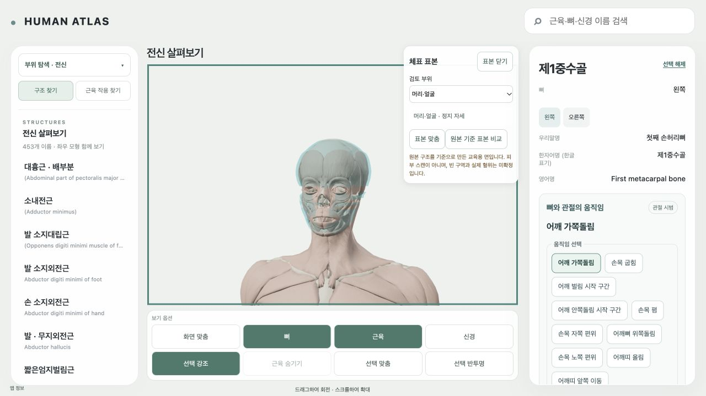

# AT4 — 머리·손발·구강·회음의 부분 carrier와 접근 검사

AT2의 native envelope 방법과 AT3 공통 compiler를 확장해 **72개 부분 chunk**를 생성하고 기존 11개 몸통·팔·다리 binary를 보존한 공통 manifest에 등록했다. 생성·정합·원본 재현과 AT4의 지원/미지원·접근 검사를 수행했다. 이것은 교육용 구조 기준 면이다. 피부 스캔, 완전한 전신 피부, 실제 혈위의 승인 결과가 아니다. 새 point/anchor와 승인 instance는 **0개**이고 기존 AC1/AC2의 미확정 proposal 22개는 그대로다.

AGENTS, 최신 EXECUTION/NEXT, AT4 명세, 30/31 설계와 AT3 실제 geometry/runtime/screenshot evidence를 확인했다. AC1 오른손 및 AC2 왼손 손톱 probe를 다시 사용했다. 역사 writer를 실행하지 않고 기존 `world()` reader만 읽어 source-local GLB/unit matrix를 한 번 적용했다. 원본 Blender는 frame 0, autoexec/script 비활성 상태로 읽었으며 저장하지 않았다. source 다운로드·수정은 0이다. 읽은 선행 및 공통 구현 hash는 [source-contract.json](../evidence/AT4/source-contract.json)에 있다.

| 계약 | 실제 값 |
|---|---|
| Source revision | c7010a903b75a2fd24a13b1c2c4c3546a9223780 |
| 원본 Blender SHA-256 | 9f08a17ea0115fed80b2a73ecdf0a1bc2ab2f6956f37c593ce23d513ea35afcd |
| Frame / unit | HUMAN_ATLAS_RH_M_XLEFT_YHEAD_ZANTERIOR / metre |
| Runtime 정지 pose | za-c7010a9-9f08a17ea011-frame0-static |
| 원본 probe pose | ZA-9f08a17ea0115fed-frame0-autoexec-off |
| 권리 | 기존 Z-Anatomy CC BY-SA 4.0 / BodyParts3D CC BY-SA 2.1 Japan attribution 유지; 개별 upstream ancestry는 새로 주장하지 않음 |
| 분리 상태 | local technical observation supported / skin accuracy unresolved / professor review not_performed / public redistribution held |

공통 생성기 `buildEducationCarriers.py`에 `--config` 입력만 확장했다. 세부 부위 config는 `education-special-inputs.json`, 접근/가림 계약은 `education-r1/access.json`이며 common manifest가 파일 hash를 참조한다. 정합 규칙은 원본 골격/객체 단면과 component bounds를 사용한다. 머리·손가락·회음은 y 단면, 발·발가락·혀는 z 단면이다. 머리 6 mm, 손발 core 3 mm, 손가락/회음 2 mm, 발가락 1.5 mm, 혀 1 mm, 손발톱 0.7 mm의 radial 여유는 시각적 분리용이며 피부 두께가 아니다.

| 추가 family | chunk | vertices | triangles | binary bytes |
|---|---:|---:|---:|---:|
| 머리·얼굴 | 1 | 841 | 1,446 | 28,860 |
| 양손 core·각 손가락 | 12 | 1,092 | 1,278 | 33,876 |
| 양발 core·각 발가락 | 12 | 1,215 | 1,424 | 37,704 |
| 양측 손발톱 판·주름 | 40 | 1,704 | 1,868 | 52,104 |
| 혀 원본 기준 | 1 | 129 | 138 | 3,924 |
| Anal/Urogenital 구역 기준 | 6 | 804 | 952 | 25,008 |
| AT4 추가 합계 | **72** | **5,785** | **7,106** | **181,476** |

양측은 각각의 실제 source vertex/triangle/transform을 사용하며 mirror는 사용하지 않았다. 손발톱 40 component는 해당 쪽 다섯 말절골과 독립 대조했다. 가까운 bone vertex 거리는 0.983–8.534 mm이며 한 native 객체마다 다섯 손가락/발가락에 일대일 대응한다. 이것은 부위 대응 검사이고 손톱 모서리의 취혈 위치 승인이 아니다. 원본 hidden/held 상태를 learner anatomy eligibility로 승격하지 않았다. 특수 source 입력 중 빈 `Regions of perineum.j`는 제외했다.

719개 원본/분리 component의 2,373,653개 detail triangle을 offline 검사했다. 새 reference vertex 5,785개를 모두 source triangle/barycentric로 재현했고 최대 오차는 5.961214369e-08 m이다. 실제 원본 극점 29개로 major region·좌우를 대조했다. 제외 면 8,758개와 native ray 부재 991개는 기록하고 열린 상태로 유지했다. cap, nearest fallback, component 사이 연결, 다른 외피로의 point 이동은 없다. 검사 후보 209,190쌍에서 proper triangle intersection은 0개다. 이 검사는 coplanar tangency 및 완전한 closed-volume containment를 제외하므로 모든 피부 관통 부재를 주장하지 않는다. compiler의 7개 내부 radial sample 검사는 별도로 유지했다.

| 부위 | 실제 표현 가능 / 접근 | 미지원·필요 입력 |
|---|---|---|
| 머리 | 전면·오른측·후면·왼측 원본 근육/뼈 외곽 기준 면. 같은 카메라에서 native/proposal 비교 | 두피/모발선·눈꺼풀·입술·정밀 구멍·피부 두께: 정합된 피부와 얼굴 landmark 필요 |
| 손끝 | 양측 손등·손바닥 방향, 다섯 독립 손가락 기준 면 | 지문 패드·주름·정밀 손끝 피부 없음. **양측 검지 끝 약 9.04 mm reference gap**을 미지원으로 유지 |
| 발끝 | 양측 발등 방향 및 inferior 발바닥 방향, 다섯 발가락 기준 면 | 족저/발가락 패드·주름·정밀 발톱 인접 피부: 해당 피부와 landmark 필요 |
| 손발톱 | 실제 양측 판/주름 5개씩, 총 40 component. 손등 및 위쪽 발등 방향 | F-cun·모서리 위치를 승인하지 않음. 인접 피부/모서리의 원문·기하 대조 필요 |
| 입 안 | 정지 입 주변에서 일부 혀 기준 면이 보이나 근육/뼈 가림이 있음. 검토자가 기존 layer를 직접 OFF하면 분리된 138 triangle 표본을 확인 가능 | 잇몸·입술소대·혀밑 점막/소대 없음. 열림 접근 자세 또는 검증된 section과 해당 점막 입력 필요 |
| 회음 | 원본 Anal/Urogenital 구역의 6개 부분 기준 면. 전면/inferior에서 일부 보이고, 검토자의 layer-off로 분리 확인 | **회음 피부·정확한 항문/생식기 경계·회음체 및 성별 anatomy 검증 없음.** 아래쪽 카메라만으로 취혈 표면 확보가 되지 않음 |

입 안의 GV28 영향은 [KMCRIC GV28](https://www.kmcric.com/database/acupoint/GV/GV28)의 잇몸/입술소대 위치 기준과 대조했다. 회음 CV1/GV1은 각각 [CV1](https://www.kmcric.com/database/acupoint/CV/CV1), [GV1](https://www.kmcric.com/database/acupoint/GV/GV1)의 해당 지역 landmark가 필요하다. 외부 좌표·시술 정보를 사용하지 않았다. access manifest의 손발 영향 코드 목록은 AI 작성 후속 검증 후보이며 이번 point 배정/승인이 아니다. 미지원 point는 anchor 없는 상태로 남긴다.

기존 DEV 표본 진입, loader/hash validator, overlay, AnatomySceneController 및 CameraSessions를 재사용했다. 새 인체·renderer·전역 camera manager·task별 overlay를 만들지 않았다. 표본 진입/부위 전환은 카메라를 움직이지 않는다. DEV 검토 패널의 작은 `표본 맞춤` 버튼만 사용자가 명시적으로 누를 때 실제 bounds를 기존 controller로 맞춘다. 기존 0.56초 보간/reduced-motion 분기를 사용한다. 수동 canvas 입력은 표본 카메라 소유권을 해제하고 기존 controller가 이동을 취소한다. 종료 시 자동 복귀하지 않는다. 보기옵션·관찰 시점 메뉴·홈·로딩 디자인은 변경하지 않았다.

module과 부위 binary는 기존 취소 가능한 lazy loader를 사용한다. 선택/움직임/비활성화는 정지 표본을 해제한다. camera owner가 해제되어도 motionOverrides가 있으면 생성/맞춤을 차단한다. 변경된 경혈 carrier를 source ID 선택으로 위장하지 않았다. 검토 중 기존 anatomy 선택 흐름을 별도로 확인했다.

| 비용 | 측정 값 |
|---|---:|
| 전체 83 chunk binary | 813,096 bytes |
| 공통 manifest | 98,925 bytes |
| 접근 manifest (runtime 미요청) | 4,275 bytes |
| 전체 표본 GPU position/normal/index | 813,096 bytes / textures 0 |
| 전체 표본 triangles / 최대 draw calls | 40,520 / 83 |
| 보수적 overview + carrier | 20,954,537 bytes |
| 접근 manifest까지 포함한 worst case | **20,958,812 / 20,971,520 bytes** |
| 보수적 overview triangles + carrier | **937,732 / 1,000,000** |
| production 초기 JS | 1,324,012 bytes, 기존 값 유지 |

overview 잔여는 접근 manifest까지 계산하면 **12,708 bytes**에 불과하다. 후속 자료가 무조건 더 들어갈 수 있다고 보지 않는다. 부위 단위 로드와 기존 예산을 유지한다. runtime의 장면 실제 draw/triangle 값과 위 전체 보수적 합계는 구분한다. driver heap/GPU 시간/FPS 보장은 측정하지 않았다. private evidence/source cache/DEV carrier 진입은 production learner bundle에서 제외되는 것을 확인했다.

자동 검사는 12개 관련 unit test, TypeScript, shared geometry replay/intersection audit, 손발톱 독립 원본 대조, production Vite build/lazy/distribution 검사다. 실제 **21개 접근 시점과 15쌍 동일 시점 native/proposal 비교**를 검사했다. 3회 반복에서 전체 carrier 증가량은 GPU 813,096 bytes / 40,520 triangles / 83 draw calls였고 OFF마다 buffer 6,947,334 bytes / registered updates 0의 기준값으로 돌아왔다. layer-off, 빠른 마지막 부위 적용, 로딩 중 OFF, motion 시작/변형 guard, 수동 맞춤 인계와 복귀 없음이 통과했다. console 경고·오류는 0개다.

카메라·source 선택·레이어·자원·취소·motion 결과는 `runtime-validation.json`, 접근 시점별 JSON/PNG 및 `actual-access-views.json`에 있다. 주 화면 검증은 root `c5c6be18-8928-497d-87fd-3c0897cff545`에서 수행했다. 종료된 탭의 마지막 클릭 전후 capture가 중복되어 그 검사는 기각하고, 새 정지 페이지의 불변 전후 파일로 다시 검사했다. 전체 표본 위 흉부 클릭이 기존 오른쪽 대흉근 흉늑부 카드를 선택하고 표본을 해제했다. 재검사도 해당 페이지 내에서는 동일 root이며 새 renderer를 기능 안에 추가한 것이 아니다. HMR/개발 페이지 재열기와 기능 ON/OFF의 root 보존을 구분한다. 수동 QA에서 바꾼 시점은 원래 카메라의 완전한 재현이라고 주장하지 않는다. 원래 오른쪽 넙다리 선택·레이어와 정지 자세를 복원했다. 실제 1280px 검토 화면과 마지막에 일시 좁아진 창의 화면을 구분했으며 후속 AT7 모바일 flow를 완료했다고 세지 않는다.

원본/OpenSim_Models/T13/역사 evidence/사용자 WIP 보존 및 정확한 소유 commit 목록은 `close-preservation.json`, `commit-scope.json`, `commit-receipt.json`에 기록한다. 생성 최초 winding 결함은 수정하고 전체를 재검사했다. Blender 첫 sandbox 실행 실패 후 script 비활성 원본 읽기를 재시도해 성공했으며 원본 저장은 없었다.

AT4의 부분 입력·공통 등록·지원/미지원·실제 접근 검사를 완료했다. 전신 피부 완료나 특수 부위 취혈 정확성은 미완이다. 다음 입력 unit은 검지/손발 패드 피부, 잇몸·입술소대 점막, 성별·자세가 명시된 회음 피부/landmark이며 다른 exterior로 대체하지 않는다. 최신 order와 AT5.dependsOn=[AT4]를 대조해 다음 ID는 **AT5**다. 이 AT record와 feature nextUnit만 갱신하고 sync/check를 실행한다. [다음 프롬프트](../evidence/AT4/next-AT5-prompt.txt)는 저장만 했으며 AT5·push·배포·진단·치료·침 시뮬레이션은 실행하지 않았다.

재현: NumPy 환경에서 `python atlas-web/scripts/buildEducationCarriers.py --evidence-dir work/evidence/AT4 --config atlas-data/acupoints/carriers/education-special-inputs.json`, `python atlas-web/scripts/validateEducationCarriers.py --evidence-dir work/evidence/AT4`, `python work/evidence/AT4/validate-special-inputs.py`, `python work/evidence/AT4/validate-runtime.py`.
