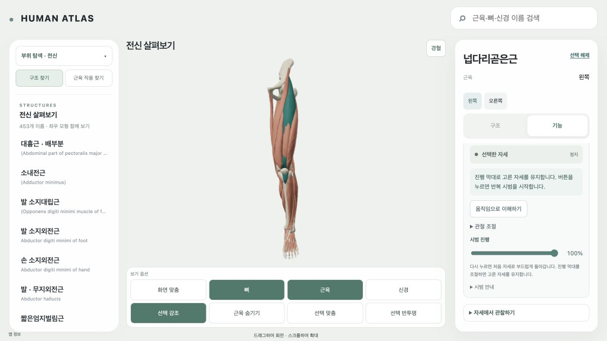
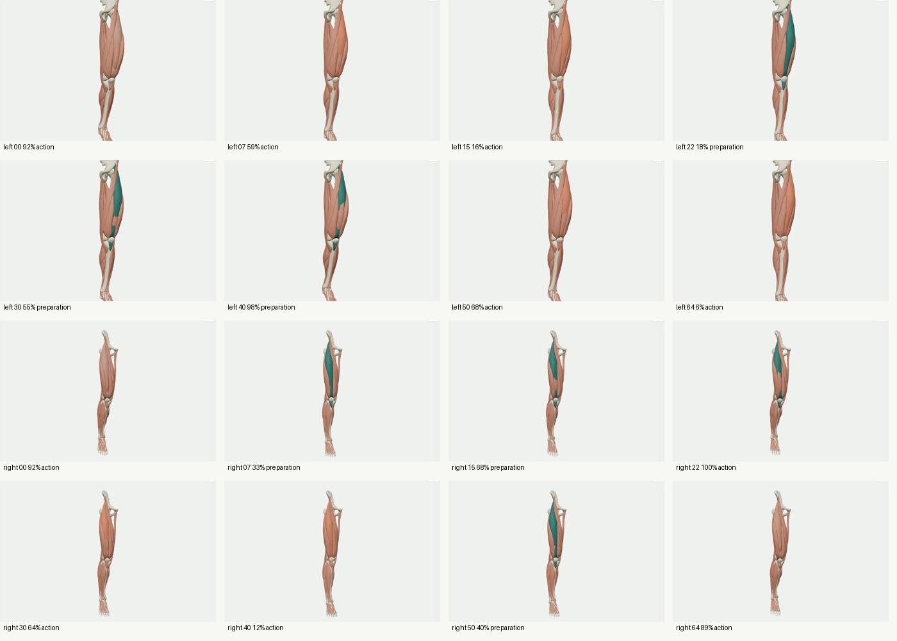
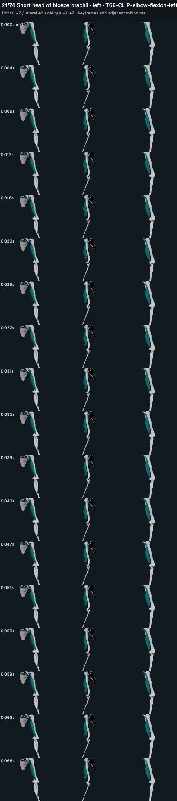
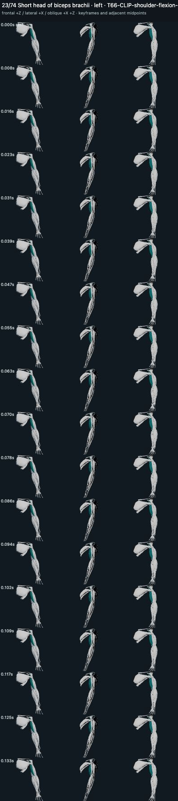
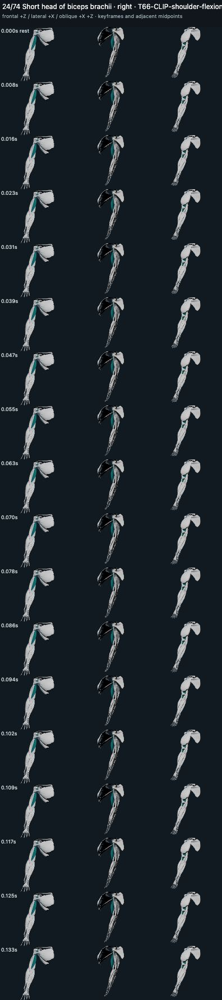

# MV2 — 대퇴직근 좌우 무릎 돌출 수정

2026-10-12 / 담당 Sol High / 실행 묶음 `MV1-Q01-rectus-femoris-knee-contour`.

이번 Q01 묶음은 **engineering acceptance 통과**다. **MV2 전체는 partial**이며 4묶음·32개 observed_ambiguous 매핑이 남는다. MV1의 미관찰 수는 0이고, 그 34건을 사람 승인 대기나 미조사로 해석하지 않았다. 역사 MV1 판정과 220장/74조합/332 learner-flow 원장은 변경하지 않았다. 이번 결과는 생리적 자연 수축, 실제 부착 footprint 또는 정상 ROM 승인과 구분한다.

시작 HEAD는 `6651c2049e0bb2e1e5215723e166cf6d5fc5ee51`. [시작 상태·소유 경계](../evidence/MV2/2026-10-12-q01-r1/start.json)와 NUL 구분 원본 status를 보존했다. 지정 authoring·원본 GLB·geometry/QC 의존 입력 50개 hash가 등록값과 일치했다. 동결 MV1의 17 입력/73 GLB hash도 비교했고 이번에 소유한 learner resolver 한 파일을 제외하면 일치한다. 전수 조사를 재실행하지 않았다.

원인은 **부착 역할과 가중치 영역의 잘못된 배정**이다. 기존 입력은 움직이는 무릎뼈를 대퇴직근의 fixedBoneKeys에 포함했고, 이동 mask에 y=0.6486m 부근의 근복 정점까지 포함했다. 근복의 fractional rotation이 먼 무릎 pivot을 중심으로 회전하면서 양측 최대 82.868mm, 앞쪽 약 71.1mm의 돌출을 만들었다. 실제 emitted 결과가 최종 가중치 공식과 일치한다. 근위 고정 mask 오류나 frame 변환 중복이 이 돌출을 만든 것은 아니다. 대퇴직근에 vector contact corrective는 없고, contact pin/weight relaxation이 잘못 배정된 mask를 유지한 채 작동했다. LINEAR의 인접 one-hot morph 보간은 spline overshoot를 만들지 않았으며, clip 끝은 굽힌 준비 자세이고 역재생이 무릎 폄이라는 매핑도 맞았다. [수치 진단](../evidence/MV2/2026-10-12-q01-r1/diagnosis-numeric.json).

정성적인 기시/정지와 무릎 폄 관계는 [UAMS lower limb table](https://medicine.uams.edu/neuroscience/education/medical-school-courses/human-structure-module/anatomy-tables/muscle-tables/muscles-of-the-lower-limb/)의 rectus femoris/quadriceps 항목을 대조했다. 문헌 관계와 이 모델의 source-region annotation을 분리했다. 실제 좌우 원본 overview의 정점 521(무릎뼈 위쪽 sleeve 부근)과 275(원위 taper/근복 전환 부근), sourceKey·matrix·geometry hash를 기록했다. 이 두 지표와 경계는 AI가 작성한 교육용 모델 지표이며 측정된 부착 면이 아니다. 좌우의 실제 source 행렬·정점을 각각 읽었으며 mirror를 검증으로 대신하지 않았다.

고정 hip/femur 쪽과 이동 patella/tibia 쪽의 영역을 바로잡고, 원위 sleeve/taper에서만 무릎 회전 가중치를 전환했다. 첫 후보는 97시점 검사에서 20건의 면 방향 실패 표본이 나와 폐기했다. 최종 후보는 기존 authorer의 free-weight 국소 shape relaxation을 한 번 적용했다. 검증 임계값을 바꾸지 않았다. **각 GLB의 node 47 POSITION/NORMAL morph 12개만 교체**했고, 다른 70개 node·원본 POSITION/index·pivot·axis·19.5°·3초·LINEAR track·역재생은 유지했다. 대퇴직근 고관절 시범과 대흉근은 수정하지 않았다. 대흉근은 별도 shoulder/linear-blend 경로이며 이번 knee mask 원인을 공유한다는 근거가 없다. [비교 기록](../evidence/MV2/2026-10-12-q01-r1/pectoral-cause-comparison.json).

기존 registry와 사용자 WIP를 덮지 않도록 [source-pinned 교체 manifest](../../atlas-data/motion/source-motion-repairs-r1.json)를 기존 learner resolver/asset delivery에 연결했다. 두 실제 learner 참조만 바뀐다. 원본 hash와 전체 frame/pose/side/topology/camera/playback binding이 달라지면 교체 candidate는 null로 격리된다. 실제 GLB loader와 현재 장면의 원본 geometry/LOD/hash 검사는 그대로 수행된다. 데이터와 검증이 없는 이름 변경이나 fixture 승격은 없다.

| 관련 검사 | 결과 |
|---|---|
| 최종 양측 emitted 보간 | 각각 97시점, 뒤집힘 0, 새 hip/femur/patella/tibia contained vertex 0 |
| 면적·edge | 최소 source 면적비 약 0.622, 최대 edge 상대 변화 약 0.522; 기존 .1 기준 유지 |
| 실제 loader vs 독립 replay | 194시점 일치, 최대 약 1.14e-16m |
| 근위부/원위부 | 고정 오차 0; 이동 mask 보간 경로 오차 <1e-9m |
| 원상복귀 | 실제 loader/controller 원본 좌표 일치; learner 양측 종료 후 progress 0, motion=null, update 0 |
| 실제 화면 | 양측 준비·50%·최대·역재생·복귀와 측면 주변 구조, 동일 camera/target 전후 비교 |
| UI 캡처와 판독 구분 | 최종 cycle 42+43장 캡처; 대표 6장씩을 contact sheet로 직접 판독, 최대 전후·측면 별도 확인 |
| 테스트 / 빌드 | 관련 20 tests, package build 13 checks 통과; 기존 dist를 덮지 않은 격리 출력 |
| 기존 경혈 흐름 | 같은 root에서 motion 종료→LU9 태연 카드/점/경로/AT21 부분 색 면→OFF/닫기; console error/warn 0 |

[왼쪽 전후](../evidence/MV2/2026-10-12-q01-r1/comparison-left.png), [오른쪽 전후](../evidence/MV2/2026-10-12-q01-r1/comparison-right.png), [실제 learner/복귀](../evidence/MV2/2026-10-12-q01-r1/README.md), [실제 loader 검사](../evidence/MV2/2026-10-12-q01-r1/real-loader-validation.json), [보간 검증](../evidence/MV2/2026-10-12-q01-r1/emitted-validation.json).

왼쪽 GLB는 3,077,372→3,297,068 bytes, 오른쪽은 3,078,676→3,298,376 bytes다. 원본을 보존하며 새 morph stream을 추가한 source payload 증가이고, geometry/animation 배열 비용은 각각 2,711,754/28,808 bytes로 유지된다. 실제 loader의 보수적 active-memory 추정은 6,037,630/6,038,938 bytes다. 같은 71개 표면과 1,488-face 대퇴직근 topology를 사용하며, renderer geometry 배열도 기존과 같은 7,493,256 bytes를 관찰했다. driver VRAM 실측이라고 주장하지 않는다. 각 자산의 8MiB 제한과 기존 장면 예산을 올리지 않았다. 격리 빌드는 기존 원본과 새 두 자산을 함께 보존하므로 전체 배포 파일에는 새 두 GLB 비용이 추가되며, learner 재생은 선택한 새 자산만 지연 로드한다.

source local-use 결정은 상속하되 public redistribution=held, humanReview=not_performed를 유지한다. AI 작성 provenance는 위의 source-addressed annotation/repair 기록에 남는다. 생체역학 solver나 환자 진단·치료·침 시뮬레이션은 수행하지 않았다.

소유 변경은 두 새 GLB, source-pinned repair manifest, 공통 교체 resolver와 delivery 연결/관련 테스트, 이 report/versioned evidence, EXECUTION의 MV2 record다. 원본/OpenSim_Models/T13/AT7/AT21와 기존 사용자 WIP 45개 tracked 파일 및 소유 외 untracked 경로는 제외한다. 커밋 전 보존·소유 검사와 로컬 commit receipt는 이 evidence 디렉터리에 남기며, 실제 commit hash와 포함/제외·잔여 변경은 최종 응답에서도 보고한다. push/배포는 없다.

[최신 수정 큐](../evidence/MV2/2026-10-12-q01-r1/repair-queue.json)에서 Q01 두 건만 resolved_engineering이며 다른 상태는 그대로다. [잔여 unit](../evidence/MV2/2026-10-12-q01-r1/remaining-units.json): Q02 외복사근 1, Q03 위팔두갈래근 3, Q04 손 말단 26, Q05 깊은 몸통 2. 별도 MV2 재개 시 우선 Q02의 실제 layering 원인만 조사한다. 현재 입력이 없어서 막힌 것이 아니며 새 사용자 요청 없이 실행하지 않는다.

예정된 다음 앱 task는 **AT22**다. 최신 `featurePlans.acupoint-at-361.order/nextUnit` 및 AT21 완료와 대조했다. AT record/feature plan은 변경하지 않는다. 다음 프롬프트:

```text
HUMAN ATLAS에서 AT22만 수행해라. 최신 AGENTS.md, EXECUTION/NEXT, work/tasks/AT22.md와 30/31 설계, AT21 실제 mask/evidence 및 MV2 Q01 결과를 읽어라. 개발 review의 canonical-carrier triangle brush/지우기/undo·redo/동일 카메라 전후 비교와 revision 저장 한 경로만 구현·검증해라. point/route/carrier hash와 이번 motion repair 및 AT7 카메라를 보존해라. AT22 명세의 경계/인수 검사·versioned evidence·sync/check·소유 로컬 commit을 완료하되 다른 MV2 잔여 묶음/다음 task/push/배포를 자동 실행하지 마라.
```

별도 수정 재개 프롬프트:

```text
HUMAN ATLAS에서 MV2의 MV1-Q02-left-external-oblique-lateral-layering만 재개해라. 최신 MV2 repair-queue/remaining-units와 변경된 input hash를 읽고 기존 MV1 전수 조사를 반복하지 마라. 실제 learner·원본/authoring에서 이웃 mesh, source topology, 가중치, 접촉/보간을 분리해 원인을 진단하고 근거가 있는 최소 수정만 해라. 해결된 Q01 좌우 무릎 자산과 AT7/AT21·사용자 WIP를 보존하고 다른 묶음/AT22/push/배포를 자동 실행하지 마라.
```

구현·검증 로컬 commit: `3ee4587b12a7c8482d699f48fda71a0c430f0ae5` (361 files). 커밋 직후 기존 status 5,966건이 시작 원본과 byte 단위로 일치하고 index가 비어 있음을 확인했다. [로컬 영수증](../evidence/MV2/2026-10-12-q01-r1/local-commit-receipt.json)을 후속 문서 checkpoint로 함께 보존한다.


## 2026-10-12 재개 — q01-learning-quality

이번 unit은 **교육용 작용 표현 통과**다. 기존 Q01 돌출 수정의 engineering pass는 보존했다. 최신 후보라는 이유로 r8을 승인하지 않았으며, 실제 비교 후 **r9**를 양측 learner 교체 자산으로 채택했다. 전체 MV2는 **partial / acceptancePassed=false**다. Q02–Q05 4묶음·32매핑은 기존 observed_ambiguous 상태를 유지하며 이번에 조사하거나 승인하지 않았다. MV1 미관찰 0과 기존 220/74/332 검사는 재사용했다.

[최종 판정](../evidence/MV2/2026-10-12-q01-learning-quality-r1/validation-final-r1.json), [새 큐](../evidence/MV2/2026-10-12-q01-learning-quality-r1/repair-queue.json), [잔여 unit](../evidence/MV2/2026-10-12-q01-learning-quality-r1/remaining-units.json).

### 복원한 중단 지점과 소유 범위

시작/재개 HEAD는 AT22 완료 커밋 `b9b041fa579ac463fd6158e8a5d37b7d71cb9853`다. 재개 시 실제 manifest는 r5를 가리켰고, r8은 후보 폴더에만 있었다. 기존 45 WIP와 보호 입력 1,771개 hash가 시작 기록과 일치했다. 원본 Q01 교체본 `a82d6459…` / `2c09324f…`, original base `04b6461e…` / `5d8fb2a5…`도 보존했다. 기존 생성/검사를 반복하지 않고 남은 loader/앱 검사와 실제로 발견한 r8 접촉 잔여의 국소 보완만 이어갔다.

소유 구현은 새 GLB 2개와 `source-motion-repairs-r1.json`의 두 row URI/hash/bytes/revision뿐이다. original base URI/hash와 전체 binding signature는 불변이다. 원본에 직접 대응하는 교체이며 runtime patch chain이 없다. 새 renderer/rig/근육별 runtime 분기, 카메라 정책·거리·연출·UI·보기옵션 변경은 없다. 기존 resolver, actual loader/controller와 offline source reader/contact corrective를 재사용했다. 공통 authoring 및 viewer 파일의 기존 WIP는 수정하지 않았다.

### 관찰·작성·채택 근거

기존 수정본은 source 근복 영역을 고정하고 원위 전환 구간만 움직여, 주요 근복의 길이 변화를 보여주는 데 부족했다. 원본 upper 12 vertex의 실제 좌표와 centroid, distal sleeve vertex 521 및 taper 275를 양측 source matrix로 각각 읽었다. source origin→sleeve 축에 근거한 material coordinate와 9개 native section centroid를 작성했다. 이는 AI의 교육용 모형 지표다. 측정된 기시 footprint나 근섬유가 아니다. 잘못된 원래 hip-fixed 52개를 그대로 복사하지 않았고, 실제 근위 neck 61개를 고정했다.

r9는 source sleeve 이동의 **축 방향 성분**을 기존 distal weight와 부드러운 분포에 연결한다. patella의 횡방향 이동은 기존 원위 sleeve에 남기며, 근복 전체를 knee pivot으로 돌리지 않는다. distal 153개는 기존 통과본의 LINEAR 경로를 정확히 유지한다. 기존 접촉 보정은 표면 정합 도구로 사용했다. 통째 scale/rigid 이동, 임의 부풀림, 색 변화, 숨김, 각도 축소로 수축을 대신하지 않았다.

| 구분 | 왼쪽 | 오른쪽 |
|---|---:|---:|
| 근복 section-centroid 경로: 처음→준비 | 291.710→303.523mm | 291.709→303.523mm |
| 작용 구간 3→0초의 경로 단축 | 11.814mm | 11.814mm |
| 주요 근복 최대 이동 | 12.909mm | 12.909mm |
| 고정 근위부 오차 | 0 | 0 |
| 원위 기존 경로 오차 | <2nm | <2nm |
| 최소 면적 비 / 최대 edge 변화 | 0.578 /0.248 | 0.578 /0.248 |
| 면 뒤집힘 / 네 기준 뼈의 새 contained vertex | 0 /0 | 0 /0 |

3초 clip의 0→3은 무릎을 굽히는 준비, 3→0은 무릎 폄 작용이다. 경로는 준비 중 증가하고 작용 중 단조 감소한다. 이것은 약 4%의 **모형 경로 변화**이며 실제 fascicle 수축률·조직 물성·volume·정상 ROM 인증이 아니다. 기존 19.5° pivot/좌표계/pose/양측 topology와 다른 70 node의 모든 sampled pose는 그대로다.

이전 시도는 versioned evidence에 보존했다. r2/r6은 뒤집힘, r3/r7은 과도한 edge 변화로 제외했다. r4/r5의 전체 sleeve-vector 보정과 비교해 r9의 축 방향 변형은 면적/edge 품질이 낫다. r8은 새 광근 contained 표본 6/7/8, 새 표본의 nearest-depth 최대 2.664mm가 남았다. r9의 기존 wrap 적용 후 각각 **3/3/2**, 최대 **1.850mm**로 줄었다. r8 record에 r5의 wrap 설명이 남았던 오류는 원본을 덮지 않고 `r8-annotation-corrigendum.json`으로 정정했다.

**한계는 남는다.** 원래 source/accepted pose에도 광근 vertex overlap이 있으며, r9에도 위 추가 국소 겹침이 있다. 새 표본의 nearest-depth 측정은 기존 already-inside 깊이 증가나 모든 triangle 교차를 검증한 것이 아니다. 기존 네 뼈 접촉 기준은 유지하고 통과했지만, 모든 연부조직 충돌이 없는 정확한 생체 모형이라고 주장하지 않는다. 이 알려진 거친 표면 근사를 포함한 local teaching demo를 판정했고, 교수 검토/생체역학 인증/공개 재배포 승인과 분리했다.

### 실제 emitted 파일·앱 검증

- 좌우 각각 **193시점**을 actual `loadAnimationScene` / `AnimationPlaybackController` / Three `getVertexPosition`+matrixWorld로 읽었다. 독립 GLB replay와 최대 차이는 0 /1.15e-16m다. compaction 전후 71 node 재생 오차0, 원본 대비 다른70 node 변화0이다. 준비·역방향 작용·왕복 경계·빠른 재시작·0.7초 복귀 후 원상복귀를 확인했다.
- 실제 **1280×720** 앱에서 양측 0/50/100, 준비·작용·반복 1배속과 오른쪽 100→90%의 느린 보간, 측면의 무릎/근육/뼈 관계를 확인했다. 1배속 시리즈 **175장**을 기록했고, 대표16장을 모은 contact sheet와 별도 static/측면/부착 화면을 판독했다. 캡처 수를 전수 시각 승인 수로 세지 않았다. 왼쪽 근위부가 잘리던 초기 확대 증거를 보존하고 전체 부착 문맥 화면을 추가했다.
- 기존 통과본과 최종본의 실제 전후는 같은 viewport에서 수동 정합했다. target 오차0, camera 위치 잔차 **0.87mm**를 명시한다. bit-identical camera라고 주장하지 않는다. 각 learner session 내부의 root/renderer는 유지했으며, 의도적인 reload/DEV route의 다른 UUID를 합쳐 한 session으로 세지 않았다.
- 빠른 중단/재시작, 재생 중 다른 근육 선택, 원본 geometry/선택/레이어 복귀를 확인했다. 무관한 대흉근 100/50 및 종료를 비교했다. 해당 원본 URI/hash는 불변이며, Q01과 동일한 원인으로 판정하거나 대흉근 전체 자연스러움을 승인하지 않았다.
- 변형 자세에서 경혈 진입은 ‘정지 자세에서 다시 열어 주세요’로 차단되어 정지 좌표 overlay가 노출되지 않았다. 대퇴직근 종료→LU7 점/경로/AT21 부분 면→닫기 후 source motion=null, update0, camera owner=null, native 배열 **6,947,334 bytes**·선택·레이어·camera가 복원됐다. 대흉근 종료 후 같은 왕복도 확인했다.
- AT22의 DEV triangle fixture 882면을 열고 닫아 기존 root/camera/선택/레이어와 native 배열 복원을 확인했다. 편집하거나 새 revision을 저장하지 않았다. AT22의 원래 36검사/13단계/화면 evidence를 재사용하며 이를 새 ST 영역 검증으로 세지 않는다.

관련 자동 검사 **17/17**, typecheck를 포함한 isolated package build **13/13** 통과. 최종은 `related-tests-r9.log`, `build-final-r2.json`이다. 역사 전체 suite를 재실행하지 않았다. 기존 large-chunk warning과 예산 threshold는 유지했다. 실제 browser warn/error0이며 임시 viewport/tab을 정리했다.




### 비용·권리·기록·정지

| actual loader 비용 | 기존 Q01 왼쪽/오른쪽 | 최종 왼쪽/오른쪽 |
|---|---:|---:|
| 파일 bytes | 3,297,068 /3,298,376 | **3,128,960 /3,130,044** |
| geometry 배열, morph 포함 | 2,711,754 | **2,925,450** |
| animation 배열 | 28,808 | **30,684** |
| source+geometry+animation 추정 | 6,037,630 /6,038,938 | **6,085,094 /6,086,178** |
| 파일 triangles /source node | 37,087 /71 | **37,087 /71** |

RF target12→24로 geometry 배열은 213,696 bytes 증가했지만 미사용 accessor49개 정리로 파일은 약168KB씩 감소했다. 총 loader 추정은 약47KB씩 증가한다. 같은 왼쪽 비교 구도의 render calls59/triangles34,099는 그대로다. DOM native/base-array 통계는 morph target을 포함하지 않으므로 전체 GPU 비용으로 대신 쓰지 않았다. 위 수치는 실제 배열 용량/호출 계수이며 driver VRAM 실측은 아니다. 20MiB overview /96MiB geometry /1M triangles /8MiB repair 예산은 올리지 않았다. 실제 lazy fetch/parse/attachment latency는 각 PNG의 JSON player profile에 남겼다. 종료 시 motion bytes0과 update0, native geometry 복원을 확인했다.

최종 왼쪽 SHA-256 `ab259d772f166d8417959680e5b7a1e1fd7de34e3320ee25169b7e22c318cde4`, 오른쪽 `60fa091ca479ba6d237cfe25a4e7b91776542793137e3b2bff1ddebb02cb8b53`. 두 파일은 `atlas-data/assets/motion/mv2-q01-learning-r1-{left,right}/motion.glb`이며 actual manifest/hash/binding을 대조했다. source-only/local-use 상속, AI 작성, humanReview=not_performed, publicRedistribution=held를 보존한다. 실패 후보/전체 authoring/evidence/private source를 learner bundle에 넣지 않는다.

최신 EXECUTION을 다시 읽고 **MV2 record와 motion-quality-review.lastDisposition만** 갱신했다. MV2 전체 acceptance=false, 이번 lastRun acceptance=true를 구분한다. AT/AC/T record와 acupoint plan은 불변이다. sync_execution.py는 Updated 0, --check는 Execution projections match; no writes로 통과했다. 원문 결과는 evidence에 남겼다. 커밋 포함은 위 두 GLB/repair manifest/이 보고서/versioned evidence/EXECUTION이다. 원본/OpenSim/T13/AT21/22/기존45 WIP 및 기존 미추적 파일은 제외한다. 실패 후보 GLB·uncompact·loader world dump·isolated build 출력은 versioned 위치에 보존하되 Git/learner bundle에서 제외한다.

다음 수리 큐는 **MV2 Q02**이며 [붙여 넣을 프롬프트](../evidence/MV2/2026-10-12-q01-learning-quality-r1/next-prompt-MV2-Q02.txt)를 남겼다. 경혈 계획의 현재 다음 ID는 **AT8**이다. 이번에는 q01-learning-quality만 수행했고 다음 묶음/AT8/위임/push/배포를 실행하지 않았다. 소유 커밋 hash와 최종 잔여 status는 완료 답변 및 해당 Git 기록에서 확인한다.


## 2026-10-12 Q02 — 왼쪽 외복사근 측면 겹침 판정·공통 예산 계약

**이번 Q02 한 묶음은 local teaching 검사 통과, 전체 MV2는 partial / acceptancePassed=false다.** 원본부터 존재하는 접힌 표면·복근 겹침과 반대쪽 시점 가림을 구분했다. 실제 국소 화면에서 Q02에만 생기는 분리·튀는 윤곽·면 뒤집힘은 확인되지 않아 **GLB geometry를 변경하지 않았다.** 모든 해부 형태가 정상이라는 판정이 아니다. 실제 연부조직 겹침 한계는 아래에 남겼다. Q01 engineering 및 q01-learning-quality r9 통과를 보존했고, Q03–Q05 **3묶음·31매핑**은 observed_ambiguous로 유지했다. MV1 전수 조사는 반복하지 않았다.

[최종 검증](../evidence/MV2/2026-10-12-q02-r1/validation-final.json), [새 큐](../evidence/MV2/2026-10-12-q02-r1/repair-queue.json), [잔여 unit](../evidence/MV2/2026-10-12-q02-r1/remaining-units.json).

### 종료된 기준선·원본 대응

담당 Sol xhigh. 시작 HEAD는 Q01 learning-quality 최종 커밋 `2d182a6fcce068409c804f4e7391f607c14a3b20`이며 AT22 완료 기준선을 포함한다. 다른 관련 HUMAN ATLAS 실행 대화가 idle임을 확인했다. 시작 full status·45개 tracked WIP hash·EXECUTION 원문과 소유 경계는 start.json/start-status.z에 있다. 원본/OpenSim/T13/AT21·22/역사 evidence와 Q01 원본·최종 자산을 포함한 **3,234개 보호 경로와 기존45 WIP**는 hash 불변이다.

Q02 대상은 왼쪽 `ZA-c7010a9-d75abb958e1463ceecb5430b`, `T66-PRIORITY-S04-L-OBLIQUE-ASSET`다. 오른쪽 `ZA-c7010a9-eb0bd1853a90acada85e9177`은 양측 대조이며 추가 해결 매핑으로 세지 않았다. 현재 실제 공통 파일은 `atlas-data/assets/motion/t66-priority-s04-flex/motion.glb`, **31,306,820 bytes**, SHA-256 `fd09265a937bebff65f0d1b095bc2d0350f13b7222e53a90c32bb40b80c43adf`다. 최종 emitted 파일을 그대로 재생했으며 새 GLB·새 repair row는 0개다.

최종 실제 authoring은 `work/evidence/T66/priority-trunk-2026-10-05/flex/`다. 초기 읽기에서 더 오래된 enlargement-trunk 후보의18.2° ledger를 발견했으나 learner에 적용하지 않았다. 최종은 기존 **14°/2.5초/16 morph target**이며 clip·poseControl과 일치한다. 수정하지 않은 실제 입력으로 판정했다. 이전 ledger에서 읽은 fixed/moving mask가 최종과 같음을 대조했고 diagnostic-input-correction.json에 구분했다. 현재 hash와 맞는 기존 bone contact65시점 QC와 compaction 영수증을 재사용했다. 과거 미사용 buffer 정리로36,508,640→31,306,820 bytes가 됐으며 모든 used accessor는 그대로다. 이미 compact된 파일을 다시 생성하거나 주변365표면을 삭제하지 않았다.

### 원인별 판정과 실제 표시

- **source/frame/side:** 양측 node309/332의 native POSITION/NORMAL/index/matrix는 source reference와 같다. metre, XLEFT/YHEAD/ZANTERIOR frame과 왼쪽 reflection을 실제 loader/node matrix로 확인했다. 시점을 반대쪽으로 돌리면 선택한 왼쪽 표면이 가려지는 사례를 보존했으며 이를 mesh 소실로 세지 않았다.
- **부착·pivot·weights:** 실제 골반/갈비뼈·척추 source 주소를 쓰는 기존 teaching field다. 골반은 고정되고 흉곽은 source 척추 구간의3.5°×4 굽힘을 따른다. EO 하부3427정점 고정·상부961정점 역할은 source-Y partition의 교육용 mask이고 측정된 부착 footprint가 아니다. Q01의 vertex 번호·knee mask를 복사하지 않았다.
- **접촉·표면:** 보이는 주름과 늑골 부근의 톱니형 외곽은 처음 자세와 native 복귀에서도 존재한다. 기존0.25 context opacity는 그대로다. 색·투명도·숨김·전체 scale·각도 축소로 오류를 가리지 않았다. 가까운 좌우 준비/중간/최대/복귀에서 넓은 표면의 변형과 골반·늑골 관계를 확인했다. 임의로 표면을 밀어내면 source 형태/부착 관계를 바꾸므로 새 geometry 보정을 채택하지 않았다.
- **보간·역방향:** 최종 LINEAR stream을 양측129시점씩 실제 `loadAnimationScene` / `AnimationPlaybackController` / Three `getVertexPosition`+matrixWorld로 읽었다. forward가 몸통 굽힘 작용, 돌아가는 방향이 원래 자세 복귀다. 면 뒤집힘0, 고정 영역 오차0, 최소 면적비0.29864와 최대edge 변화0.41690이다. 최대 표면 이동은 양측60.34mm다. 기존 실제 hash의 mask-centroid 간격 단축27.03mm도 재사용했으며 근섬유 수축률로 부르지 않았다.

**한계:** 원래 native EO→IO winding 표본은 양측2665개 unique vertex 중291개가 안쪽이다. 다섯 실제 자세의 전체unique vertex 검사에서 새 EO→IO 표본은 양측 각3개, nearest surface 깊이 최대 **0.81747mm**였다. 복횡근/배곧은근에는 새 표본0이다. 처음의240정점 제한 probe에서는 왼쪽 새 겹침이0이었지만 더 넓힌 결과3을 최종에 사용했다. 표면이 완전한 닫힌 조직이 아니므로 winding·nearest 결과를 모든 triangle 교차/실제 생체 접촉으로 확대하지 않는다. 기존 뼈 접촉 기준0은 유지한다. 이 거친 모델의 알려진 겹침을 포함한 **교육용 표시/작용 이해 통과**이며 정확한 해부 정상성·생체역학·교수 승인이 아니다.

### 공통 예산 계약의 최소 수정

`motionAssetBudget.ts`에서 기존 정확한 URI+SHA의31,306,820-byte ceiling을 공유한다. resolver와 delivery는 그 **원본에 직접 연결되는 repair만 동일한 기존 ceiling을 상속**한다. 다른 자산은8MiB 그대로다. 기존 본체나 전체 geometry 예산을 올리지 않았다. 기존 repair의 완전한 side/frame/pose/source binding signature 검사도 유지한다.

배포 경로는 실제 원본 파일의 containment/hash/bytes를 먼저 확인하고 repair의 실제 길이가 선언bytes와 같은지 확인한 뒤200/304와 build emit을 허용한다. repair→repair chain, drifted base, ceiling+1, 잘못된 선언길이, 변조된 실제 원본 및 index metadata에 끼운 임의byteBudget을 거부한다. 마지막 metadata sanitization은 실제 정상 입력/GLB/재생을 바꾸지 않아 완료한 양측 시리즈를 재생성하지 않았다. 최종 실제 HTTP 응답도200/31,306,820 bytes/해시 일치 및304를 재확인했다. 테스트용31MB 직접 교체 표본은 임시 경로에서만 검사했고 learner repair manifest에 넣지 않았다.

### 실제 앱·해제·회귀

실측1280×720의 기존 앱에서 왼쪽85장·오른쪽64장, **1배속149장**을 기록했다. contact sheet4장의 **대표41프레임**을 판독했고 별도 준비/정지 중간/최대/복귀 화면도 확인했다. 캡처149개를 전수 시각 승인149개로 세지 않았다. 검사용 수동 회전·확대만 사용했으며 제품 카메라/거리/전환 연출/UI/보기옵션/홈/로딩은 수정하지 않았다. 새 scene/root/renderer/인체 복사본은 없다.

- 각 시리즈와 좌우 전환은 같은 root/renderer를 유지했다. GLB의365개 source 표면/골반5개 고정과 주변 구조를 함께 표시했다. 빠른 재시작·중단·좌우 및 다른 근육 선택에서 motion이 해제됐고 안정된 종료값은 motionBytes0/update0이다. 빠른 선택 직후의 update1은 기존 camera transition이므로 motion leak이나 안정된0으로 바꾸어 기록하지 않았다.
- 대흉근의 별도 자산100/50 및 종료는 기존 재생·전환 회귀만 확인했다. Q02와 같은 원인이나 대흉근 전체 자연스러움으로 승인하지 않았다. Q01 최종 두 GLB/manifest는 불변이며 related resolver 검사를 통과했다.
- 변형 자세에서 경혈은 ‘정지 자세에서 다시 열어 주세요’로 차단됐다. 종료→LU7 실제 점/경로/AT21 부분 색 면→닫기를 확인하고 원래 선택/레이어/geometry로 복원했다.
- AT22 DEV fixture882면을 편집·저장 없이 열고 닫았다. 초기 close 직후 전환 중 snapshot은 보존하고, 최종r2는 동일root/camera·선택·레이어, native6,947,334 bytes/update0, camera owner=null을 확인했다. 기존 AT22의 편집 suite를 반복하거나 ST 영역을 새 승인하지 않았다.
- layer-off 검사는 마지막 plugin reload 뒤에 필요한 부분만r2로 다시 확인했다. 뼈OFF가 로드/변형/종료에도 유지됐고 마지막에 초기 뼈ON 설정으로 되돌렸다. reload 전후의 다른 UUID를 하나의 session으로 합치지 않았다. browser warn/error0이다.

관련 자동 검사 **21/21**, typecheck 포함 isolated package build **13/13** 통과했다. 최종 로그는 related-tests-final.log/build-final-r2.json이다. 원래dist를 건드리지 않았고 build 출력·private source/evidence를 learner bundle에 넣지 않았다. 실제 무결성·비용·앱 표시와 수치 검사를 별도로 남겼다.

| 실제 최종 loader 비용 | Q02 전/후 동일 |
|---|---:|
| 파일 bytes |31,306,820|
| geometry 배열, morph 포함 |30,384,012|
| animation 배열 |191,692|
| source+geometry+animation 추정 |61,882,524|
| motion 표면 /triangles /draw calls |365 /320,362 /365|

첫 load166.9ms/오른쪽87.5ms는 해당 desktop 표본이며 휴대폰 성능 보장이 아니다. native cache 배열9,313,398 bytes→motion base-array 합13,319,370→종료9,313,398을 확인했다. DOM base-array 수치에는 morph가 빠지므로 driver GPU VRAM으로 부르지 않는다. loader morph 포함 용량과 calls/shader count는 위 실제 evidence에 있다. geometry96MiB/triangles1M 및 기존source ceiling을 조용히 늘리지 않았다.

### 기록·커밋·다음 한 unit

최신 EXECUTION을 다시 읽고 **MV2 record 및 motion-quality-review.lastDisposition만** 갱신했다. 이번lastRun acceptance=true와 전체acceptance=false를 구분하고 Q01 lastRun을 priorLearningQualityRun에 보존했다. AT/AC/T record 및 acupoint plan의nextUnit=AT8은 불변이다. `sync_execution.py` 및 `--check` 결과는 별도 로그에 남긴다.

커밋 포함은 공통 예산 모듈/검사, sourceMotionRepairs와 motionAssets 관련 검사·최소 수정, 이 report/versioned evidence 및 EXECUTION이다. GLB/repair manifest/원본/OpenSim/T13/AT21·22/기존45 WIP·기존5921미추적 파일은 제외하고 보존했다. isolated build 출력은 로컬에 보존하되 Git에서 제외한다. 로컬 commit hash·선별 포함 목록·남은status는 evidence/commit-receipt.json과 최종 답변에 남긴다.

다음 수리는 **MV2 Q03 세 이두근 매핑 한 묶음**이다. [붙여 넣을 프롬프트](../evidence/MV2/2026-10-12-q02-r1/next-prompt-MV2-Q03.txt)를 남겼다. 전체 MV2 잔여는 Q03(3)/Q04(26)/Q05(2), 합31매핑이며 선택적humanReview는not_performed다. 경혈 계획의 다음은 **AT8**이다. 이번에는 Q02만 수행했고 다른 수리/AT/위임/push/배포는 실행하지 않았다.


## 2026-10-12 Q03 — 이두근 3매핑 현행 learner 도달성·작용 판독

**Q03 partial / acceptance=false.** Q01 돌출 수정, q01-learning-quality, Q02 통과는 보존했다. 이번 continuation은 Q03만 보완했다. 기존 r4 출력 GLB·authoring·registration hash가 모두 동결된 MV1 group21/23/24와 일치하므로 변형 자산은 수정하지 않았다. 실제 learner 화면에서 resting target highlight는 확인했으나 exact clip의 full action/return과 관련 복귀 흐름은 모두 완료하지 못했다. 세 mapping은 `not_checked`이며 prior MV1/Q03 observations의 `observed_ambiguous`를 그대로 분리해 둔다. 자연스러운 수축 통과가 아니다.

[인수 checkpoint](../evidence/MV2/2026-10-12-q03-r2/resume-checkpoint.json), [화면 관찰 addendum](../evidence/MV2/2026-10-12-q03-r2/learner-screen-addendum.json), [결함 후보 분류](../evidence/MV2/2026-10-12-q03-r2/defects.json), [갱신된 repair queue](../evidence/MV2/2026-10-12-q03-r2/repair-queue.json), [remaining units](../evidence/MV2/2026-10-12-q03-r2/remaining-units.json), [validation](../evidence/MV2/2026-10-12-q03-r2/validation.json). 2026-10-11 MV1 contact sheets와 Q03 r1 동결 입력은 덮어쓰지 않고 참조했다.

### 기준선·실제 최종 입력

Q03 원 시작 HEAD `fa37d4109e33e4e31082570ac9d74e2708685e1f`, 현재 continuation HEAD도 동일하다. Q02 완료 기준 `5b51ff627ea048ee4d0c0f9e526a46268d96d094`는 시작 HEAD의 ancestor다. 시작 status는 r1 checkpoint의 628 entries / 45 tracked edits / 583 untracked이며 SHA-256 `5d808680bb46e312adee3a7324bc8e63070a59799267fa470d2afe42740f5f42`다. 이번 continuation 전 snapshot은 629 compressed entries / 45 tracked / 584 untracked, SHA-256 `39cd57d0f08e4e2a3c7df1763b00e2015847d37db23b44bd13363c9868f42411`이다. 기존 45 tracked edits, 기존 미추적 후보/r3 파일, OpenSim_Models/T13/역사 freeze/user WIP를 보존했다. EXECUTION/report는 continuation 직전 clean이었다.

| MV1 group | side · sourceKey | registered learner pose observation | actual emitted GLB / SHA-256 / bytes | authoring SHA-256 |
|---|---|---|---|---|
| 21 elbow flexion | left · `ZA-c7010a9-b20b574e456449c5d571c7a1` | `팔꿈치 굽힘 자세에서 관찰`; source-family bound, targetJointIds empty | `t66-unit01-elbow-flexion-left-source-frame-r4/motion.glb` · `a263144376925c2ece792c965347f26911e6c6b9de4cc29dfc398983e8e3844d` · 2,100,760 B | `3eb8a4273f8a9af8603f73aed7a55f3ff853b7957f65fb4e836311ca66bccc68` |
| 23 shoulder flexion | left · same sourceKey as group21 | `어깨 앞쪽 굽힘 자세에서 관찰`; separate clip, same sourceKey, targetJointIds empty | `t66-unit01-shoulder-flexion-left-source-frame-r4/motion.glb` · `13cb37b2d1bf048626cb79d46ed28a3c2f6453f1d19444c106e46b6ec2403e86` · 1,519,788 B | `71e5ace420cebbcd2fad2a1296a1f491a8e4d4c69f6b5805ac74624027818c65` |
| 24 shoulder flexion | right · `ZA-c7010a9-a0c2ea00609e874a7faa926d` | `어깨 앞쪽 굽힘 자세에서 관찰`; source-family bound, targetJointIds empty | `t66-unit01-shoulder-flexion-right-source-frame-r4/motion.glb` · `8f7e3a5ea0a27a4b2a6254ce65c6b8ed01c99dab67f2e2e0266a7fed12225b96` · 1,518,568 B | `3df7de6e1c13891b574b5738179d1d949d17080cd340a7ca8802a08dcff3899d` |

현재 GLB actual SHA/bytes, expected/registered SHA, Q03 start snapshot, motion-learning row 및 source-frame-r4 authoring `motionSha256`가 세 mapping 모두 일치한다. 기존 authoring은 각각 정확한 short-head source-surface pose observation이며 elbow 15°, shoulder 12°의 교육용 pose다. measured anatomical axis, attachment footprint, physiological ROM은 없다. group23은 group21과 sourceKey가 같지만 별도 clip이므로 한 재생 검사를 다른 mapping의 통과로 세지 않았다. 미등록 r3/plain WIP 후보는 그대로 보존했고 runtime 등록/최종 자산으로 채택하지 않았다.

### 정적 검사 재사용 범위와 실제 learner 화면

변경하지 않은 QC를 hash 기준으로 재사용했다. elbow는 513 interpolation geometry sample, 각 shoulder는 257이며 기존 기록에서 geometry/contact flags가 통과하고 flipped-face sample은 0이다. final-pose QC와 actual GLB→authoring hash 일치도 확인했다. rigid-trajectory 파일은 aggregate pass boolean 없는 transform diagnostic이며, continuous collision freedom을 주장하지 않는다. 이 수치로 수축 자연성, 완전 충돌 자유, 해부 정상성은 승인하지 않았다. 입력/코드 변경이 없어서 새 tests/typecheck/build는 실행하지 않았다.

실제 native Chrome learner에서 left source route로 짧은갈래를 선택했을 때 기본 whole-body view에 선택 강조 teal이 보이고 주변 구조가 남아 있었다. 기능 탭에는 작용 미선택, disabled 재생과 disabled progress slider(0%)가 표시됐다. `근육 작용 찾기`에서 `팔꿈치 굽힘` 검색 결과는 0개였고 “이 범위의 근육 작용 시범은 준비 중입니다” 안내가 나타났다. 따라서 current-run group21 clip action/return은 수행하지 못했다. 이전 Q03 session의 group21 1x progress 22/53/62/74/48/43과 MV1 group21 0.25x action+return은 재생성하지 않고 재사용 evidence로만 남겼다.

right source route는 오른쪽 side/짧은갈래 선택 및 구조 탭까지 실제로 열렸다. 기능 탭으로 가려는 클릭에서 Chrome이 사용자 제어 변경을 알렸고 이후 입력을 멈췄다. group24의 action/return을 검사했다고 주장하지 않는다. group23의 별도 어깨 clip 선택/재생도 이번 화면에서 성립시키지 못했다. 이전 MV1 slow evidence는 group23/24 action-only를 보여줄 뿐 완전 복귀 승인이 아니다. 현재 CUA 화면 이미지는 도구 결과에서 육안으로 확인했으나 이 경로에 screenshot file export가 없어 workspace screenshot으로 직렬화하지 않았다. 동결된 MV1 frame sheets를 아래 재사용한다.





### 원인 후보·수정·남은 정확한 unit

확정된 geometry/mechanical defect는 0건, confirmed cause 없음, repair 0건이다. 다음 판독 대상으로 source-family action reachability/clip binding, 측면 레이어 occlusion과 native surface overlap, elbow/shoulder pivot·weights·side/frame·contact, 완전 왕복과 선택/복귀를 분리해 남겼다. 이는 결함 후보이며 정적 형태 변화나 action 미재생만으로 원인을 단정하지 않았다. human review는 `not_performed`다.

이번 Q03 acceptance를 막는 실제 unit은 아래뿐이다.

1. group21 left elbow: 안정된 learner에서 exact clip의 기존 선택 경로를 찾고 1x/필요 시 slow 전체 cycle, 준비·중간·최대·역방향 복귀, 정면/측면/사선 attachment/neighbor, 빠른 stop/restart, muscle/side/layer 복귀, point/territory 재진입을 관찰한다.
2. group23 left shoulder: group21과 같은 sourceKey라도 shoulder clip을 별도로 선택하고 full cycle·중간 프레임·접촉·복귀를 확인한다.
3. group24 right shoulder: user-control이 끝난 learner에서 function/action path와 full cycle을 확인하고 좌우/주변구조/복귀·재진입을 대조한다.
4. 실제 결함이 관찰된 경우에만 source/frame/side, pivot, weights, interpolation, contact를 분해해 공통 offline authoring/source-bound repair 여부를 결정한다.

Q03 3개 mapping은 모두 승격하지 않았다. 전체 MV2는 여전히 Q03/Q04/Q05 3 groups / 31 mappings partial이며 `nextScheduledTask=AT8`, automatic execution=false다. Q04/Q05/AT8은 실행하지 않았다. 이번 변경 범위는 MV2 record/해당 lastDisposition/report/versioned Q03 evidence이며 기존 generated projection WIP 및 다른 파일은 stage하지 않는다.


## 2026-10-12 Q03 continuation r3 — 실제 learner playback 확인

**Q03 통과(등록된 posture_observation 재생 경로와 화면 판정 범위). 전체 MV2는 partial이며 acceptancePassed=false다.** Q01 engineering, q01-learning-quality, Q02 결과를 유지했다. Q03의 세 clip은 같은 source의 두 어깨 동작을 별도로 선택해 각각 확인했다. 근육 작용 검색 결과 0건을 자료 부재로 판단하지 않고, 실제 `기능 → 자세에서 관찰하기 → 정확한 동작 선택 → 움직임으로 이해하기` 경로를 사용했다.

[재개 시작·소유 경계](../evidence/MV2/2026-10-12-q03-r3/start.json), [실제 learner 상태·시각 판정](../evidence/MV2/2026-10-12-q03-r3/learner-screen-addendum.json), [검증 요약](../evidence/MV2/2026-10-12-q03-r3/validation.json), [repair queue](../evidence/MV2/2026-10-12-q03-r3/repair-queue.json), [정확한 잔여 unit](../evidence/MV2/2026-10-12-q03-r3/remaining-units.json), [localhost 페이지·모듈·GLB 응답](../evidence/MV2/2026-10-12-q03-r3/server-asset-verification.log).

| group / option | side · source | clip | 현행 GLB (SHA-256 · bytes) | 화면 판정 |
|---|---|---|---|---|
| 21 / 298 | left · `ZA-c7010a9-b20b574e456449c5d571c7a1` | elbow flexion | `a263144376925c2ece792c965347f26911e6c6b9de4cc29dfc398983e8e3844d` · 2,100,760 | pass |
| 23 / 297 | left · same source, separately selected | shoulder flexion left | `13cb37b2d1bf048626cb79d46ed28a3c2f6453f1d19444c106e46b6ec2403e86` · 1,519,788 | pass |
| 24 / 299 | right · `ZA-c7010a9-a0c2ea00609e874a7faa926d` | shoulder flexion right | `8f7e3a5ea0a27a4b2a6254ce65c6b8ed01c99dab67f2e2e0266a7fed12225b96` · 1,518,568 | pass |

세 자산은 이전 r4 등록 hash와 일치했고 localhost 실제 GET도 전부 200 및 같은 byte/hash를 반환했다(합계 5,139,116 bytes). 현재 learner에서 left elbow, 같은 left source의 별도 shoulder clip, right shoulder clip을 정확히 열었다. 각 clip은 1배속 한 주기/역방향 또는 반복 진행/중간 자세/최대 부근/정지 후 0% 복귀를 확인했다. 화면은 대상 short head를 teal로 강조하면서 견갑·상완·팔꿈치·전완 등 주변 구조를 함께 표시했다. 샘플된 화면에서 새 부착부 이탈, 관통, 접힘/뒤집힘, 과도한 돌출, 주변 분리 또는 갑작스러운 pop은 확인되지 않았다. 동일 asset hash의 기존 interpolation/contact/final-pose 검증(팔꿈치 513, 어깨 각 257 sample; 기록된 면 뒤집힘 0)을 재사용했다. 이 정적 QC와 표본 화면은 모든 각도의 충돌 부재나 정상 생리 수축을 뜻하지 않는다.

공통 흐름은 뼈 레이어 OFF→ON 복원, 재생 중지/원자세 복귀와 재시작 조작, 경혈 학습에서 왼쪽 LU7 열결 선택 후 닫아 같은 왼쪽 short-head/기능/팔꿈치 선택으로 복귀하는 것을 확인했다. 근육 레이어는 계속 ON이었다. 필요 slow-motion 관찰은 추가하지 않았다. 세 옵션 모두 UI가 **주변 구조 관찰이며 선택 근육 자체의 작용 시범이 아님**을 표시한다. 따라서 Q03 기술·학습화면 pass는 posture observation 전달만 승인하며, 이두근 수축·해부학적 부착 정확도·임상 정상 범위·사람 검토를 승인하지 않는다. `humanReview=not_performed`, `publicRedistribution=held`, physiological certification=false다.

기하·authoring·등록·runtime 수리는 확인된 원인이 없어 하지 않았고 기존 GLB 원본을 보존했다. 새 제품 테스트/typecheck/build는 입력 변경이 없어 실행하지 않았다. 실제 Safari 화면은 CUA 도구 출력에서 판독했으며 도구의 screenshot API가 local file export를 제공하지 않아 새 screenshot binary 파일은 evidence 폴더에 직렬화하지 않았다. 해당 화면 접근 관찰과 frozen MV1 frame sheets의 재사용 경계는 위 JSON에 기록했다.

이 Q03 unit 뒤에도 전체 MV2는 **partial**이다. Q01/Q02/Q03 세 그룹·6매핑이 resolved 범위이고, Q04 26 + Q05 2 = 28매핑이 미검사로 남는다. `nextScheduledTask=AT8`와 auto-execution=false를 유지했다. 다음 정확한 unit은 Q04/Q05의 별도 사용자 요청이며 이번에는 실행하지 않았다. AT, Q04, Q05, push 및 배포는 하지 않았다.
